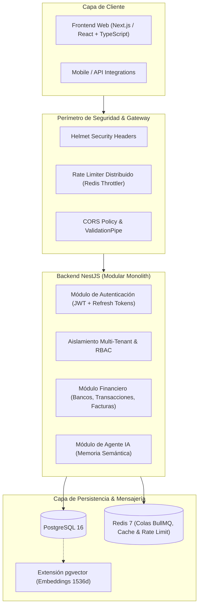

# 💼 MyBusiness — Plataforma Financiera y Contable Inteligente

[](https://github.com/Umbrex47/mybusiness/issues/10)
[](https://nestjs.com/)
[](https://github.com/pgvector/pgvector)
[](https://redis.io/)
[](#seguridad-y-cumplimiento)
[](#devops-y-cicd)

**MyBusiness** es una plataforma integral de gestión financiera, contable y operativa para empresas y personas independientes. Diseñada bajo una arquitectura modular multi-inquilino (Multi-Tenant) de alta seguridad, combina la gestión transaccional tradicional con capacidades avanzadas de **memoria semántica vectorial e inteligencia artificial**.

---

## 🏗️ Arquitectura del Sistema

La solución adopta el patrón **Modular Monolith** desacoplado, facilitando el escalado progresivo y la mantenibilidad:



---

## 💻 Stack Tecnológico

| Capa / Componente | Tecnología | Propósito |
|---|---|---|
| **Backend** | [NestJS](https://nestjs.com/) / [TypeScript](https://www.typescriptlang.org/) | Framework empresarial modular, inyección de dependencias y tipado estricto. |
| **Frontend** | [Next.js](https://nextjs.org/) / [React](https://react.dev/) / Tailwind CSS | Interfaz moderna, reactiva, accesible y optimizada. |
| **Base de Datos Relacional** | [PostgreSQL 16](https://www.postgresql.org/) | Persistencia transaccional ACID con soporte de particionado e integridad referencial. |
| **Memoria Vectorial (IA)** | [pgvector](https://github.com/pgvector/pgvector) | Búsqueda por similitud semántica de embeddings para el agente financiero. |
| **Colas y Caché** | [Redis 7](https://redis.io/) | Gestión de tareas en segundo plano (BullMQ), rate-limiting multi-instancia y sesiones. |
| **Seguridad & Criptografía** | Argon2id, AES-256-GCM, Passport JWT | Hashing robusto de passwords, rotación de tokens y cifrado en reposo. |
| **Contenedores** | [Docker](https://www.docker.com/) & Docker Compose | Entornos reproducibles de desarrollo y staging. |
| **CI / CD** | [GitHub Actions](https://github.com/features/actions) | Pipelines automatizados de linting, tipado, tests e integración. |
| **Análisis de Seguridad** | [SonarQube](https://www.sonarqube.org/) & [Trivy](https://trivy.dev/) | Análisis estático (SAST), detección de dependencias vulnerables y escaneo de contenedores. |

---

## 🗄️ Modelo de Datos Core

El esquema de base de datos se estructura en torno al aislamiento estricto por inquilino (`tenantId`):

1. **`Tenant` (Company)**: Representa la empresa o entidad jurídica independiente (RUT/RFC/NIF, configuración fiscal, moneda, timezone).
2. **`User`**: Identidades del sistema con roles definidos (`SUPER_ADMIN`, `TENANT_ADMIN`, `ACCOUNTANT`, `AUDITOR`, `VIEWER`), credenciales hasheadas en Argon2id y soporte multi-empresa.
3. **`BankAccount`**: Cuentas bancarias de la compañía (ahorros, corriente, crédito), saldos actuales y conciliados.
4. **`Transaction`**: Movimientos monetarios (ingresos, egresos, transferencias), deduplicación mediante claves de idempotencia y vinculación bancaria.
5. **`Invoice`**: Facturación de clientes y proveedores (cuentas por cobrar y por pagar), estados de vencimiento y cálculo de impuestos.
6. **`AuditLog`**: Tabla *append-only* inmutable que registra quién, cuándo, desde qué IP y qué datos modificó para trazabilidad total.
7. **`AgentMemory`**: Almacén de memoria episódica y contextual del agente de Inteligencia Artificial mediante vectores embeddings (`vector(1536)`) indexados con HNSW.

---

## 🔐 Seguridad y Cumplimiento

- **Rotación Cifrada de Tokens**: Los Refresh Tokens se cifran con AES-256 / SHA-256 antes de persistir. Cuenta con detección automática de reuso: si un token revocado es reintentado, se invalida toda la familia de sesiones activas del usuario.
- **Aislamiento Multi-Tenant**: Inyección automática del contexto de la empresa en la capa de datos para evitar fugas entre organizaciones (prevención de IDOR).
- **Rate-Limiting Distribuido**: Protección en capas mediante Redis para prevenir ataques de fuerza bruta en autenticación (máx 5 req/min) y abuso de API.
- **Headers Seguros**: Cabeceras HTTP endurecidas vía Helmet (HSTS estricto, CSP, X-Frame-Options: DENY, nosniff).

---

## 🚀 Estado del Proyecto — Fase 1 (Sprints 1 y 2)

El desarrollo del proyecto se encuentra organizado y supervisado mediante la siguiente estructura de seguimiento:

📍 **Master Epic de Seguimiento**: [#10 — Fase 1: Cimientos de Infraestructura, Seguridad y Modelado de Datos](https://github.com/Umbrex47/mybusiness/issues/10)

### Sprint 1: Infraestructura, Repositorio y Modelo de Datos
- [ ] [#1 — [Sprint 1][Setup] Configuración del repositorio y arquitectura modular monorepo](https://github.com/Umbrex47/mybusiness/issues/1)
- [ ] [#2 — [Sprint 1][Infra] Provisionamiento de PostgreSQL con pgvector y Redis](https://github.com/Umbrex47/mybusiness/issues/2)
- [ ] [#3 — [Sprint 1][Database] Diseño y modelado relacional: Tenant, User y BankAccount](https://github.com/Umbrex47/mybusiness/issues/3)
- [ ] [#4 — [Sprint 1][Database] Modelado de Transaction, Invoice, AuditLog y AgentMemory](https://github.com/Umbrex47/mybusiness/issues/4)

### Sprint 2: Autenticación, Seguridad y Pipelines CI/CD
- [ ] [#5 — [Sprint 2][Security] Autenticación robusta en NestJS con JWT y Refresh Tokens cifrados](https://github.com/Umbrex47/mybusiness/issues/5)
- [ ] [#6 — [Sprint 2][Security] Autorización RBAC y contexto Multi-Tenant hermético](https://github.com/Umbrex47/mybusiness/issues/6)
- [ ] [#7 — [Sprint 2][Security] Middleware de Rate-Limiting con Redis y endurecimiento HTTP](https://github.com/Umbrex47/mybusiness/issues/7)
- [ ] [#8 — [Sprint 2][DevOps] Pipelines de CI en GitHub Actions (Lint, Tests, Build)](https://github.com/Umbrex47/mybusiness/issues/8)
- [ ] [#9 — [Sprint 2][DevOps] Pipelines de análisis estático (SAST) y seguridad con SonarQube y Trivy](https://github.com/Umbrex47/mybusiness/issues/9)

---

## ⚡ Guía de Inicio Rápido (Desarrollo Local)

### Prerrequisitos
- **Node.js** >= 20.x
- **Docker** & **Docker Compose**
- **Git**

### 1. Clonar el repositorio
```bash
git clone https://github.com/Umbrex47/mybusiness.git
cd mybusiness
```

### 2. Configuración de Entorno
Copia el archivo de variables de entorno de ejemplo y ajusta los valores necesarios:
```bash
cp .env.example .env
```

### 3. Levantar Servicios de Infraestructura
Inicia las instancias locales de PostgreSQL (con `pgvector`) y Redis:
```bash
docker compose up -d
```

Verifica el estado de los contenedores:
```bash
docker compose ps
```

### 4. Instalar Dependencias
```bash
npm install
```

### 5. Ejecutar Migraciones y Seeders
```bash
npm run db:migrate
npm run db:seed
```

### 6. Iniciar en Modo Desarrollo
```bash
npm run dev
```

---

## 🧪 Pruebas y Calidad de Código

```bash
# Verificación de linter y formateo
npm run lint
npm run format

# Chequeo estático de tipos
npm run typecheck

# Pruebas unitarias
npm run test

# Pruebas de integración / e2e
npm run test:e2e

# Reporte de cobertura
npm run test:cov
```

---

## 🛡️ Seguridad & Contribuciones

Si descubres una vulnerabilidad potencial de seguridad en este proyecto, por favor repórtala de manera responsable a través de los canales privados de seguridad o abriendo un Security Advisory en GitHub en lugar de un issue público.

Las contribuciones siguen el estándar de [Conventional Commits](https://www.conventionalcommits.org/es/v1.0.0/) y requieren que todos los checks de CI (incluyendo análisis de SonarQube y Trivy) pasen exitosamente antes del merge.

---

## 📄 Licencia

Este proyecto está bajo la licencia [MIT](LICENSE).
