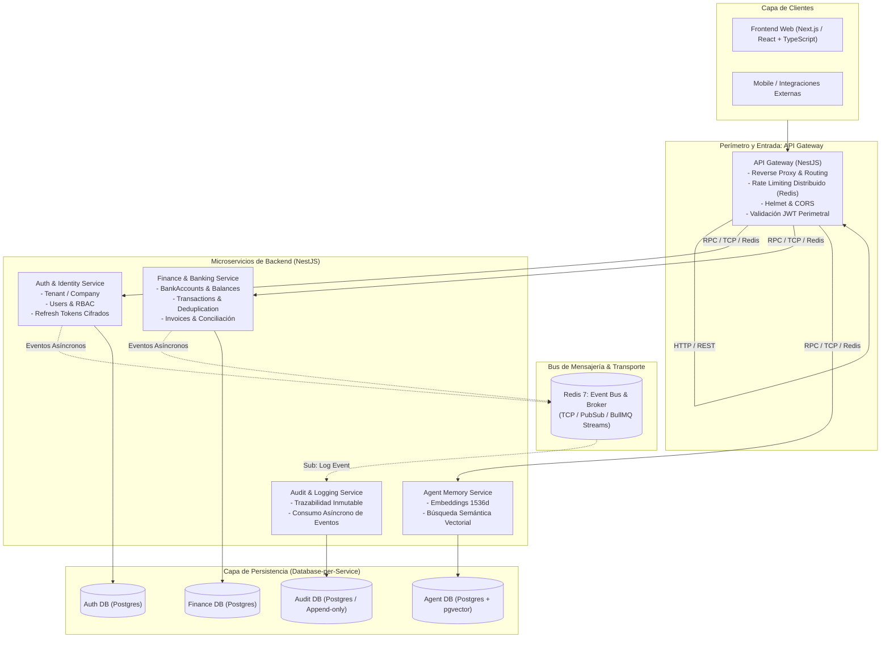

# 💼 MyBusiness — Plataforma Financiera y Contable Inteligente

[](https://github.com/Umbrex47/mybusiness/issues/10)
[](https://docs.nestjs.com/microservices/basics)
[](https://github.com/pgvector/pgvector)
[-dc382d.svg)](https://redis.io/)
[](#seguridad-y-cumplimiento)
[](#devops-y-cicd)

**MyBusiness** es una plataforma integral de gestión financiera, contable y operativa para empresas y personas independientes. El backend está diseñado bajo una **arquitectura de microservicios con NestJS** en un monorepo modular, desacoplando dominios de negocio, garantizando alta disponibilidad, aislamiento de fallos y escalabilidad elástica.

---

## 🏗️ Arquitectura de Microservicios

El sistema adopta el patrón **API Gateway + Microservicios de Dominio** con comunicación híbrida (Síncrona vía RPC/TCP y Asíncrona basada en eventos con Redis):



---

## 🧩 Catálogo de Microservicios

| Servicio | Responsabilidad de Dominio | Comunicación | Almacenamiento |
|---|---|---|---|
| **`api-gateway`** | Punto de entrada único, routing, rate-limiting, CORS, Helmet y verificación JWT. | HTTP REST (hacia clientes) / RPC (hacia microservicios) | Redis (Throttler storage) |
| **`auth-service`** | Gestión de Tenants (empresas), usuarios, login, registro, rotación cifrada de Refresh Tokens y RBAC. | RPC (Request-Response) + Eventos (UserRegistered, TenantCreated) | PostgreSQL (`auth_db`) |
| **`finance-service`** | Cuentas bancarias, transacciones con deduplicación por clave de idempotencia, facturas e impuestos. | RPC (Request-Response) + Eventos (TransactionCreated, InvoicePaid) | PostgreSQL (`finance_db`) |
| **`agent-service`** | Memoria semántica del agente de IA, indexación vectorial con pgvector (HNSW) y recuperación contextual. | RPC (Similarity Search, Store Memory) | PostgreSQL + `pgvector` (`agent_db`) |
| **`audit-service`** | Registro inmutable de auditoría (append-only), trazabilidad de acciones y cambios de estado. | Asíncrona (EventPattern subscriber vía Redis) | PostgreSQL (`audit_db`) |

---

## 💻 Stack Tecnológico

| Capa / Componente | Tecnología | Propósito |
|---|---|---|
| **Backend Framework** | [NestJS](https://nestjs.com/) (Microservices Module) | Framework modular con soporte nativo para microservicios (`@MessagePattern`, `@EventPattern`). |
| **Transport Layer** | Redis (TCP / PubSub / Redis Streams) | Bus de transporte para mensajes RPC entre servicios y eventos asíncronos desacoplados. |
| **Frontend** | [Next.js](https://nextjs.org/) / [React](https://react.dev/) / TypeScript | Arquitectura de cliente modular con Tailwind CSS. |
| **Base de Datos** | [PostgreSQL 16](https://www.postgresql.org/) | Persistencia ACID estructurada bajo patrón Database-per-Service (o esquemas aislados). |
| **Memoria Vectorial** | [pgvector](https://github.com/pgvector/pgvector) | Búsqueda por similitud semántica de embeddings para el agente de IA. |
| **Caché y Colas** | [Redis 7](https://redis.io/) / [BullMQ](https://bullmq.io/) | Rate-limiting distribuido, gestión de colas de procesamiento en segundo plano y caché. |
| **Seguridad Criptográfica** | Argon2id, AES-256-GCM, Passport JWT | Hashing de alta resistencia, rotación segura de tokens y cifrado en reposo. |
| **Contenedores** | [Docker](https://www.docker.com/) & Docker Compose | Orquestación reproducible de microservicios y dependencias locales. |
| **CI / CD** | [GitHub Actions](https://github.com/features/actions) | Pipelines automatizados de linting, typecheck, tests y builds paralelos de microservicios. |
| **Seguridad Estática** | [SonarQube](https://www.sonarqube.org/) & [Trivy](https://trivy.dev/) | Análisis estático (SAST), detección de dependencias vulnerables y escaneo de contenedores. |

---

## 📁 Estructura del Repositorio (Monorepo)

```bash
mybusiness/
├── apps/
│   ├── api-gateway/          # Entrada HTTP, autenticación perimetral, rate-limiting
│   ├── auth-service/         # Microservicio de Identidad, Tenants y RBAC
│   ├── finance-service/      # Microservicio Financiero (Bancos, Transacciones, Facturas)
│   ├── agent-service/        # Microservicio de Memoria de IA (pgvector)
│   ├── audit-service/        # Microservicio de Auditoría inmutable (Consumidor asíncrono)
│   └── web-frontend/         # Frontend Next.js / React
├── packages/
│   ├── common/               # Decoradores, filtros globales, guards compartidos
│   ├── contracts/            # DTOs, EventPatterns, MessagePatterns y contratos tipados
│   └── database/             # Clientes ORM compartidos, migraciones y utilidades de BD
├── docker/
│   ├── docker-compose.yml    # Infraestructura: Postgres (pgvector) y Redis
│   └── docker-compose.dev.yml# Orquestación completa de microservicios en local
├── .github/
│   └── workflows/            # Pipelines CI/CD y análisis de seguridad
└── README.md
```

---

## 🗄️ Modelo de Datos por Servicio

Siguiendo el principio de **Database-per-Service** (con bases de datos o esquemas independientes en PostgreSQL para mantener bajo acoplamiento):

1. **`auth-service` (`auth_db`)**:
   - `Tenant` (Company): Empresa, taxId (RUT/RFC/NIF), timezone, moneda default, estado.
   - `User`: Credenciales (Argon2id), roles (RBAC: `SUPER_ADMIN`, `TENANT_ADMIN`, `ACCOUNTANT`, etc.), asociación a tenants.
   - `RefreshToken`: Tokens cifrados (AES-256) con `familyId` para detección y revocación automática de reuso.
2. **`finance-service` (`finance_db`)**:
   - `BankAccount`: Entidad financiera, número enmascarado, moneda, saldos y metadatos.
   - `Transaction`: Monto, divisa, tipo (ingreso/egreso), idempotencyKey de deduplicación, fecha y estado.
   - `Invoice`: Facturas emitidas/recibidas, numeración por tenant, impuestos, ítems y enlace a transacción.
3. **`agent-service` (`agent_db`)**:
   - `AgentMemory`: Contenido textual, metadata y columna de vector embedding (`vector(1536)`) con índice HNSW para búsqueda por distancia coseno.
4. **`audit-service` (`audit_db`)**:
   - `AuditLog`: Registro append-only (actorId, tenantId, acción, entidad, diff de cambios, IP, user-agent).

---

## 🔐 Seguridad y Propagación de Contexto

- **Autenticación en Gateway**: El `api-gateway` valida el token JWT emitido por `auth-service` y propaga los metadatos de identidad (`X-User-Id`, `X-Tenant-Id`, `X-Roles`) de forma segura en las llamadas RPC a los microservicios internos.
- **Aislamiento Multi-Tenant**: Cada microservicio aplica internamente el filtro obligatorio de `tenantId` en sus consultas, impidiendo accesos cruzados (prevención hermética de vulnerabilidades IDOR).
- **Protección Perimetral y Rate-Limiting**: `@nestjs/throttler` en el API Gateway respaldado por Redis para prevenir ataques de fuerza bruta en login (5 req/min) y scraping indebido de APIs.
- **Trazabilidad Asíncrona**: Cada operación crítica emite un evento al bus de Redis que es procesado de forma no bloqueante por el `audit-service`.

---

## 🚀 Estado del Proyecto — Fase 1 (Sprints 1 y 2)

El desarrollo del proyecto se encuentra estructurado en torno al diseño de microservicios:

📍 **Master Epic de Seguimiento**: [#10 — Fase 1: Cimientos de Infraestructura, Seguridad y Modelado de Datos](https://github.com/Umbrex47/mybusiness/issues/10)

### Sprint 1: Arquitectura de Microservicios, Infraestructura y Datos
- [ ] [#1 — [Sprint 1][Setup] Monorepo y arquitectura de microservicios (API Gateway, Servicios y Frontend)](https://github.com/Umbrex47/mybusiness/issues/1)
- [ ] [#2 — [Sprint 1][Infra] PostgreSQL con pgvector y Redis como Event Bus/Broker y Caché](https://github.com/Umbrex47/mybusiness/issues/2)
- [ ] [#3 — [Sprint 1][Database] Esquema de Auth Service: Tenant/Company, User y BankAccount](https://github.com/Umbrex47/mybusiness/issues/3)
- [ ] [#4 — [Sprint 1][Database] Esquemas de Finance Service, Audit Service y Agent Memory (pgvector)](https://github.com/Umbrex47/mybusiness/issues/4)

### Sprint 2: Autenticación, Seguridad y Pipelines CI/CD
- [ ] [#5 — [Sprint 2][Security] Auth Service en NestJS con JWT y Refresh Tokens cifrados](https://github.com/Umbrex47/mybusiness/issues/5)
- [ ] [#6 — [Sprint 2][Security] RBAC y propagación de contexto Multi-Tenant entre microservicios](https://github.com/Umbrex47/mybusiness/issues/6)
- [ ] [#7 — [Sprint 2][Security] Rate-Limiting distribuido en API Gateway con Redis y endurecimiento HTTP](https://github.com/Umbrex47/mybusiness/issues/7)
- [ ] [#8 — [Sprint 2][DevOps] Pipelines de CI para Microservicios en GitHub Actions (Lint, Tests, Build)](https://github.com/Umbrex47/mybusiness/issues/8)
- [ ] [#9 — [Sprint 2][DevOps] Análisis estático de seguridad (SAST) y escaneo de imágenes con SonarQube y Trivy](https://github.com/Umbrex47/mybusiness/issues/9)

---

## ⚡ Guía de Inicio Rápido (Desarrollo Local)

### Prerrequisitos
- **Node.js** >= 20.x
- **Docker** & **Docker Compose**
- **Git**

### 1. Clonar el repositorio
```bash
git clone https://github.com/Umbrex47/mybusiness.git
cd mybusiness
```

### 2. Configuración de Entorno
Copia el archivo de variables de entorno de ejemplo:
```bash
cp .env.example .env
```

### 3. Levantar Infraestructura Base
Inicia PostgreSQL (con `pgvector`) y Redis (Broker de eventos y colas):
```bash
docker compose up -d postgres redis
```

### 4. Instalar Dependencias del Monorepo
```bash
npm install
```

### 5. Iniciar Microservicios en Desarrollo
```bash
# Iniciar todos los microservicios y el gateway simultáneamente:
npm run dev

# O iniciar un microservicio específico:
npm run dev:gateway
npm run dev:auth
npm run dev:finance
npm run dev:agent
```

---

## 🧪 Pruebas y Calidad de Código

```bash
# Verificación de linter y formateo en todo el monorepo
npm run lint
npm run format

# Chequeo estático de tipos
npm run typecheck

# Pruebas unitarias de microservicios
npm run test

# Pruebas de integración inter-servicio / e2e
npm run test:e2e

# Reporte de cobertura global
npm run test:cov
```

---

## 🛡️ Seguridad & Contribuciones

Si descubres una vulnerabilidad potencial de seguridad en este proyecto, repórtala de manera responsable a través de un Security Advisory privado en GitHub.

Las contribuciones siguen el estándar de [Conventional Commits](https://www.conventionalcommits.org/es/v1.0.0/) y requieren que todos los checks de CI (incluyendo análisis de SonarQube y Trivy) pasen exitosamente antes del merge.

---

## 📄 Licencia

Este proyecto está bajo la licencia [MIT](LICENSE).
