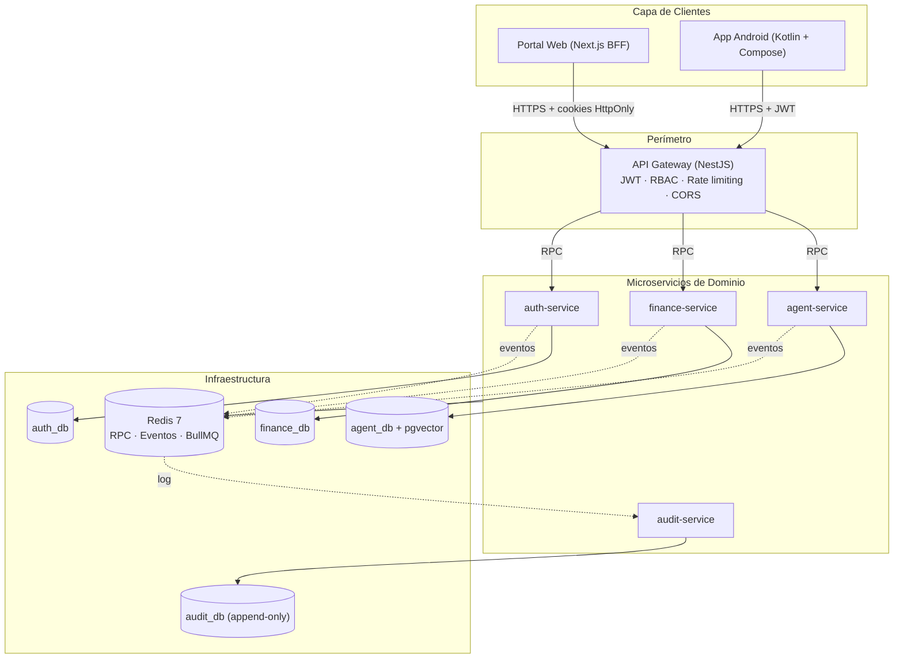

# Plan Integral de Desarrollo — MyBusiness

> **Versión:** 2.0 · **Fecha:** 2026-10-28 · **Estado:** vigente
> **Reemplaza:** plan v1 «Asistente Financiero Inteligente para Empresarios» (greenfield Flutter + Astropods) y la decisión del issue #10 «No habrá frontend web».
> **Alcance:** monorepo `mybusiness`. La planificación operativa de la Fase 2 vive en [`sprints/fase-2/README.md`](sprints/fase-2/README.md) y las issues en [`sprints/fase-2/ISSUES.md`](sprints/fase-2/ISSUES.md).

## 0. Cambios respecto al plan original

El plan v1 describía una plataforma greenfield. El repositorio ya tomó decisiones distintas y vinculantes. Este documento las adopta como línea base y sólo planifica lo que falta.

| #   | Tema            | Plan v1                             | Decisión vigente                                                 | Evidencia                       |
| --- | --------------- | ----------------------------------- | ---------------------------------------------------------------- | ------------------------------- |
| 1   | Backend         | NestJS modular (DDD)                | API Gateway + 4 microservicios NestJS con Redis RPC/Pub-Sub      | ADR-002, `apps/*`               |
| 2   | Persistencia    | PostgreSQL único                    | PostgreSQL 16 + pgvector, database-per-service                   | #2, `docker/docker-compose.yml` |
| 3   | ORM             | Prisma                              | Drizzle ORM + drizzle-kit                                        | ADR-001                         |
| 4   | Dinero          | `Decimal`/`number`                  | Enteros en unidad mínima (`*Minor`) y string en JSON             | ADR-003                         |
| 5   | Contratos       | Zod por capa                        | `packages/contracts` como fuente única                           | ADR-004                         |
| 6   | Móvil           | Flutter (iOS/Android)               | Kotlin + Jetpack Compose (sólo Android)                          | #1, #12                         |
| 7   | Web             | No existía; explícitamente excluida | `apps/web`: Next.js 15 + React + TypeScript con BFF              | ADR-006 (nuevo)                 |
| 8   | Colas           | BullMQ genérico                     | BullMQ sobre Redis 7 con backoff y DLQ                           | ADR-002, SF2-06                 |
| 9   | Vectorial       | pgvector para todo                  | `agent-service` con embeddings 1536d e índice HNSW               | #14                             |
| 10  | IA y gobernanza | Astropods como control plane        | Orquestación propia en `agent-service`; Astropods queda opcional | §2.6                            |
| 11  | Open Banking    | Fase 2                              | Se mantiene en Fase 2, dentro de `finance-service`               | §3                              |
| 12  | OCR             | Document AI / Mindee                | Puerto `OcrProvider` con adaptador inicial Mindee                | §2.7                            |
| 13  | Auth            | JWT + refresh cifrado + RBAC        | Implementado: Argon2id, refresh SHA-256, guards de tenant y rol  | #5, #6                          |
| 14  | CI/CD           | Un pipeline                         | `ci.yml` + `security.yml`; se añade pipeline del portal web      | #8, #9, SF2-02                  |
| 15  | Equipo          | 4 devs desde el día 1               | Ownership definido para 4; los ADRs se redactaron con 2 backend  | §6                              |

## 1. Resumen ejecutivo y objetivos

### Propósito

Desarrollar una plataforma integral de asistencia financiera y toma de decisiones para empresarios y directores financieros. El sistema simplifica la visualización analítica, habilita consultas conversacionales en lenguaje natural y convierte transacciones dispersas en un flujo financiero ordenado y automatizado. Los usuarios acceden desde la app Android o desde el portal web, con la misma identidad, permisos y datos.

### Objetivos

| Objetivo                      | Alcance                                                                                                                    |
| ----------------------------- | -------------------------------------------------------------------------------------------------------------------------- |
| Visualización intuitiva       | Dashboards reactivos de flujo de caja y tablas de análisis para auditoría rápida, en móvil y en navegadores de escritorio. |
| Consultas en lenguaje natural | Asistente con respuestas en streaming, generación validada de gráficos y acceso desde app o web.                           |
| Automatización transaccional  | Ingesta por Open Banking, conciliación de facturas por OCR y cobros por PayPal, con seguimiento en ambos canales.          |
| Acceso flexible y continuo    | El portal web permite operar desde un computador sin instalar la app, con la misma cuenta y permisos.                      |
| Control y trazabilidad        | Cálculos deterministas en el backend, auditoría inmutable y aprobación humana en operaciones con dinero.                   |

### Resultados esperados

- Reducir el trabajo manual de ordenar movimientos y conciliar comprobantes.
- Dar a empresarios y CFOs una lectura actualizada de caja, gastos, ingresos y proyecciones.
- Permitir acceso seguro desde móvil y escritorio con continuidad entre sesiones.
- Mantener las decisiones financieras críticas bajo controles, trazabilidad y aprobación humana.

### Canales

| Canal                      | Rol                                      | Capacidades diferenciales                                                                       |
| -------------------------- | ---------------------------------------- | ----------------------------------------------------------------------------------------------- |
| Android (Kotlin + Compose) | Consulta rápida y operación en movilidad | Biometría, notificaciones, Quick Settings Tile, widgets Glance, captura de facturas con cámara. |
| Web (Next.js)              | Análisis detallado y administración      | Pantallas amplias, tablas densas, teclado, conciliación masiva, sesiones web endurecidas.       |

Ambos canales consumen los mismos servicios del backend y respetan permisos por empresa y usuario. El canal no es una fuente de reglas de negocio.

## 2. Arquitectura

### 2.1 Vista general

### 2.2 Stack por capa

| Capa           | Decisión                                                                       | Notas                                                              |
| -------------- | ------------------------------------------------------------------------------ | ------------------------------------------------------------------ |
| Portal web     | Next.js 15 (App Router) + React 19 + TypeScript 5.7, pnpm workspace `apps/web` | BFF en Route Handlers; sin acceso directo a base de datos. ADR-006 |
| App móvil      | Kotlin + Jetpack Compose + Material 3                                          | `apps/mobile-android`; consume sólo el API Gateway.                |
| API            | NestJS con `@nestjs/microservices` y `Transport.REDIS`                         | RPC con `@MessagePattern`; eventos con `@EventPattern`. ADR-002    |
| Datos          | PostgreSQL 16 + pgvector; una base por servicio                                | Sin joins cross-service.                                           |
| ORM            | Drizzle ORM + drizzle-kit                                                      | Migraciones por servicio. ADR-001                                  |
| Dinero         | Enteros en unidad mínima, `*Minor`, string en JSON                             | Nunca `number` ni `float` para importes. ADR-003                   |
| Contratos      | `packages/contracts` (DTOs, enums, patrones, money)                            | Fuente única; prohibido duplicar DTOs. ADR-004                     |
| Autenticación  | JWT de acceso + refresh opaco con hash SHA-256, Argon2id                       | Guards de rol y tenant globales en el gateway.                     |
| Rate limiting  | Redis distribuido + fallback en memoria acotado                                | Anti-bypass por `tenantId` y IP real. ADR-005                      |
| Colas          | BullMQ sobre Redis 7                                                           | Backoff exponencial, DLQ, workers idempotentes.                    |
| CI/CD          | GitHub Actions: `ci.yml`, `security.yml` y pipeline del portal web             | Trivy + SonarCloud; cobertura con `test:cov`.                      |
| Observabilidad | Logs estructurados por servicio; OpenTelemetry en Fase 3                       | Correlación por `tenantId`, `traceId` y canal de origen.           |

### 2.3 Portal web (Next.js)

- **BFF obligatorio:** el navegador sólo habla con `apps/web`. Los Route Handlers adjuntan credenciales, aplican CSRF y proxyan al API Gateway.
- **Sesión:** cookies `HttpOnly`, `Secure` y `SameSite=Lax`; refresh rotation; revocación por dispositivo; cierre de sesión global.
- **Dos capas de cookie:** el API Gateway conserva su cookie `SameSite=Strict`; el BFF usa `SameSite=Lax` para sobrevivir a la navegación desde enlaces externos. El navegador sólo ve la cookie del BFF y ambas se documentan en el runbook para evitar configuraciones divergentes.
- **Sin secretos en el cliente:** prohibido `localStorage`/`sessionStorage` para tokens, claves bancarias o API keys.
- **Datos:** TanStack Query para caché y Mutaciones; invalidación explícita tras operaciones de dinero.
- **Tablas densas:** TanStack Table con virtualización, filtros multicriterio, ordenamiento server-side y paginación; edición en línea limitada a campos autorizados.
- **Gráficos:** ECharts (canvas) para flujo de caja, burn rate y categorías; los datos llegan calculados por el backend.
- **Accesibilidad:** WCAG 2.1 AA, navegación por teclado, foco visible, contraste y `prefers-reduced-motion`.

### 2.4 Seguridad por canal

| Control                               | Web                                                     | Android                                      |
| ------------------------------------- | ------------------------------------------------------- | -------------------------------------------- |
| Almacenamiento de tokens              | Cookies HttpOnly emitidas por el BFF                    | Keystore / almacenamiento cifrado            |
| Confirmación de operaciones sensibles | Reautenticación + confirmación explícita                | BiometricPrompt + confirmación explícita     |
| CSRF                                  | Token double-submit + verificación de origen            | No aplica (no usa cookies)                   |
| CSP                                   | `default-src 'self'`, sin `unsafe-inline` en producción | No aplica                                    |
| Rate limiting                         | Por tenant, IP real y endpoint                          | Por tenant y dispositivo                     |
| Cierre de sesión                      | Revocación de refresh + limpieza de caché               | Revocación + borrado de almacenamiento local |

Regla transversal: los cálculos, permisos y acciones financieras críticas se resuelven o verifican en el backend.

### 2.5 Persistencia, búsqueda y observabilidad

- `auth_db`: tenants, usuarios, refresh tokens.
- `finance_db`: cuentas bancarias, transacciones, facturas, conciliaciones.
- `agent_db`: memoria del agente, embeddings 1536d, índice HNSW.
- `audit_db`: bitácora append-only de eventos y acciones.
- Toda escritura financiera genera evento de auditoría; si la auditoría no está disponible, la mutación falla.
- Las trazas incorporan canal de origen, tenant y correlación de request, con minimización de PII.

### 2.6 Inteligencia artificial y gobernanza

- La orquestación vive en `agent-service`; no se adopta Astropods como dependencia dura. Si se contrata, se integra detrás de la misma interfaz de herramientas.
- El LLM **nunca** calcula saldos ni totales: recibe JSON determinista del backend y sólo redacta y propone visualizaciones.
- Herramientas expuestas por un servidor MCP interno (`get_cashflow_summary`, `list_unreconciled_transactions`, `create_payment_link`), con validación de esquema y auditoría por invocación.
- Presupuesto de tokens por tenant, caché semántica, límite duro de gasto y degradación a respuesta sin LLM al excederse.
- Human-in-the-Loop obligatorio para capturas, reembolsos, envíos de factura y cualquier movimiento de dinero.
- Conjunto de evaluación con preguntas doradas y verificación de cifras contra SQL antes de cada release.

### 2.7 Integraciones externas

| Integración  | Proveedor                                                | Fase | Notas                                                                   |
| ------------ | -------------------------------------------------------- | ---- | ----------------------------------------------------------------------- |
| Open Banking | Belvo (LatAm) y Plaid (US/global)                        | 2    | OAuth/consentimiento, webhooks firmados, sincronización idempotente.    |
| OCR          | Mindee (adaptador inicial), Document AI como alternativa | 2    | Detrás del puerto `OcrProvider`; umbral de confianza y revisión humana. |
| Cobros       | PayPal                                                   | 3    | Órdenes, capturas, reembolsos y webhooks firmados en `finance-service`. |
| Mensajería   | Redis 7                                                  | 1    | RPC, eventos y BullMQ.                                                  |

### 2.8 Contratos y paridad entre canales

- `packages/contracts` es la fuente única para TypeScript (gateway y web).
- El gateway publica OpenAPI; el portal web consume tipos generados y el cliente Android consume modelos generados desde el mismo contrato.
- Los cambios de contrato son retrocompatibles o versionados; los tests de contrato corren en CI para ambos canales.
- Prohibido que web o Android redefinan reglas de negocio, validaciones críticas o cálculos monetarios.

## 3. Hoja de ruta

| Fase | Sprints | Foco                                                       | Estado                                   |
| ---- | ------- | ---------------------------------------------------------- | ---------------------------------------- |
| 1    | 1–2     | Fundaciones, seguridad, modelado y CI                      | ~85 %: cerrada salvo #11, #13, #14 y #15 |
| 2    | 3–4     | Portal web y CI/CD, Open Banking, OCR, colas, conciliación | Planificada en `sprints/fase-2/`         |
| 3    | 5–6     | Agentes, MCP interno, gobernanza de tokens, PayPal         | Planificada en `sprints/fase-3/`         |
| 4    | 7–8     | Experiencia avanzada web y Android (streaming, OS, admin)  | Planificada en `sprints/fase-4/`         |
| 5    | 9       | Pruebas integrales, seguridad y cumplimiento               | Planificada en `sprints/fase-5/`         |
| 6    | 10      | Producción, monitoreo y lanzamiento                        | Pendiente                                |

### Fase 2 — Canales y datos (Sprints 3 y 4)

**Sprint 3 (2026-11-02 → 2026-11-13)**

- Cerrar la deuda de Fase 1 que bloquea la ingesta: #13 (dominio financiero), #14 (memoria vectorial), #15 (auditoría asíncrona) y #11 (ADRs).
- Crear `apps/web` con Next.js, design tokens y shell autenticado.
- Pipeline de CI y CD del portal web, con previews y despliegue.
- Sesión web BFF con cookies HttpOnly, CSRF, rotación y revocación.
- Open Banking: link token, consentimiento y cuentas en Belvo/Plaid.
- Webhooks bancarios firmados, idempotencia y estado de sincronización.
- BullMQ: colas, workers, backoff exponencial y DLQ.

**Sprint 4 (2026-11-16 → 2026-11-27)**

- Enlace bancario y estado de sincronización en Android.
- Confirmación biométrica para acciones sensibles en Android.
- Dashboard web de flujo de caja y burn rate.
- Libro mayor y conciliación masiva con tabla densa.
- Conciliación automática y cron nocturno de recuperación.
- OCR de facturas PDF/JPG detrás de `OcrProvider`.
- Embeddings e indexación en pgvector.
- Tests de contrato, E2E multi-canal y prueba de carga de 50.000 transacciones.

**Criterio de salida de Fase 2**

- Un usuario puede vincular una cuenta bancaria y ver sus movimientos en web y Android.
- Una factura subida desde cualquiera de los dos canales queda extraída, indexada y disponible para conciliación.
- El portal web se despliega automáticamente desde `develop` con pipeline en verde.
- La conciliación automática supera el 90 % en transacciones con comprobante legible.

## 4. Matriz de riesgos

| Riesgo                                   | Efecto posible                                      | Mitigación                                                                                                              |
| ---------------------------------------- | --------------------------------------------------- | ----------------------------------------------------------------------------------------------------------------------- |
| Alucinaciones numéricas de IA            | Decisiones basadas en cifras incorrectas            | Cálculos sólo en NestJS/PostgreSQL; el modelo recibe JSON determinista; evaluación con cifras doradas y HITL en dinero. |
| Webhooks bancarios perdidos o duplicados | Movimientos faltantes o duplicados en ambos canales | Dedupe por `providerEventId`, BullMQ idempotente, backoff exponencial, conciliación nocturna y `lastSyncedAt` visible.  |
| Costos excesivos de tokens               | Gasto no controlado por empresa                     | Presupuesto por tenant, límite duro, caché semántica y trazas por canal; el canal no puede eludir el límite.            |
| Secuestro o abuso de sesión web          | Acceso no autorizado a datos financieros            | Cookies HttpOnly/Secure, CSRF, CSP, rotación de refresh, revocación por dispositivo y reautenticación.                  |
| Exposición de datos en el navegador      | Credenciales o datos en almacenamiento del cliente  | Prohibido guardar tokens o claves; caché mínima; limpieza al cerrar sesión; sin PII en logs.                            |
| Divergencia funcional entre canales      | Reglas o controles distintos                        | API y permisos compartidos; tests de contrato y aceptación por canal.                                                   |
| Deriva de contratos TS ↔ Kotlin          | App Android desactualizada o rota                   | OpenAPI como contrato; clientes generados; verificación en CI.                                                          |
| Caída de Redis                           | Pérdida de RPC, colas o rate limiting               | Fallback de rate limiting (ADR-005); reintentos; 503 explícito en colas; nunca pérdida silenciosa.                      |
| OCR de baja calidad                      | Conciliación incorrecta o incompleta                | Umbral de confianza, cola de revisión humana, proveedor intercambiable y fallback manual.                               |
| Sobrecarga de alcance en Fase 2          | Retraso del portal web o de la ingesta              | Alcance congelado en `ISSUES.md`; chat en streaming se pospone a Fase 4.                                                |

## 5. Criterios de aceptación y definición de éxito

| Criterio                | Meta                                                        | Verificación                                                                  |
| ----------------------- | ----------------------------------------------------------- | ----------------------------------------------------------------------------- |
| TTFT conversacional     | < 1,5 s (p75)                                               | Medición desde web y Android en red acordada; trazas por canal.               |
| Conciliación automática | > 90 % con comprobante digital                              | Reporte por tenant, con estado y evidencia revisables en ambos canales.       |
| Protección de secretos  | Cero credenciales o API keys en texto plano                 | Gitleaks en CI + auditoría de almacenamiento del navegador y del dispositivo. |
| Disponibilidad          | SLA 99,9 %                                                  | API y ruta de login del portal web incluidas en el cálculo.                   |
| Acceso multidispositivo | Web y Android operativos                                    | Misma identidad, permisos y datos; pruebas por canal.                         |
| Seguridad y permisos    | Autorización en servidor y aprobación en acciones sensibles | Tests de aislamiento A/B por tenant y de escalamiento de roles.               |
| Accesibilidad           | WCAG 2.1 AA en web                                          | axe + revisión manual de teclado, foco y contraste.                           |
| Precisión monetaria     | Cero errores de redondeo                                    | Importes `*Minor`; pruebas de propiedades sobre `money.ts`.                   |

**Listo para lanzamiento**

- Las metas cuantitativas se miden y se reportan con el método acordado.
- Web y Android comparten identidad, permisos y datos.
- Las operaciones críticas tienen trazabilidad y aprobación.
- Los flujos principales están validados en dispositivos y navegadores objetivo.

## 6. Equipo y ownership

| Rol                             | Responsabilidad principal                                     | Issues de Fase 2       |
| ------------------------------- | ------------------------------------------------------------- | ---------------------- |
| Backend 1 — Datos y banca       | Gateway, contratos, Open Banking, webhooks, tests de contrato | SF2-04, SF2-05, SF2-12 |
| Backend 2 — Agentes y asíncrono | BullMQ, OCR, embeddings, conciliación                         | SF2-06, SF2-07, SF2-11 |
| Frontend 1 — Web                | Scaffold, CI/CD, dashboard                                    | SF2-01, SF2-02, SF2-08 |
| Frontend 2 — Web y móvil        | Sesión BFF, libro mayor, Android y biometría                  | SF2-03, SF2-09, SF2-10 |

Reglas de colaboración:

- Cada issue tiene un owner único; los pares revisan, no co-implementan.
- Ningún PR mezcla backend y frontend salvo cambios de contrato.
- Los cambios de contrato requieren aprobación del owner de `packages/contracts` (Backend 1).

## 7. Decisión de frontend: Kotlin nativo + Next.js

El plan v1 recomendaba Flutter para cubrir iOS, Android y web con una sola base. El repositorio ya implementó Android en Kotlin y no tiene iOS en alcance. Introducir Flutter ahora implicaría un tercer stack y reescribir la app existente.

| Criterio              | Kotlin nativo (Android)                                        | Next.js (web)                       | Flutter (descartado)                     |
| --------------------- | -------------------------------------------------------------- | ----------------------------------- | ---------------------------------------- |
| Cobertura             | Android                                                        | Web de escritorio                   | Android, iOS, web                        |
| Reutilización         | Contratos vía OpenAPI                                          | `packages/contracts` y tooling pnpm | Ninguna con el código actual             |
| Tablas densas         | Compose limitado                                               | TanStack Table + virtualización     | `pluto_grid` aceptable, ecosistema menor |
| Sesión web segura     | No aplica                                                      | BFF + cookies HttpOnly              | Requiere trabajo adicional               |
| Integración con el SO | Total: TileService, Glance, biometría, VoiceInteractionService | N/A                                 | Parcial vía Platform Channels            |
| Costo de adopción     | Ya construido                                                  | Nuevo, pero alineado al monorepo    | Reescritura de la app Android            |

**Decisión:** Android permanece en Kotlin; el portal web se construye en Next.js. Ver [ADR-006](adr/006-portal-web-nextjs.md).

Equivalencias respecto del plan v1:

| Plan v1 (Flutter)         | Decisión vigente                                                  |
| ------------------------- | ----------------------------------------------------------------- |
| `fl_chart`                | ECharts en web; Canvas/Vico en Android                            |
| `pluto_grid`              | TanStack Table en web                                             |
| `flutter_bloc` / Riverpod | TanStack Query + Zustand en web; ViewModel + StateFlow en Android |
| `local_auth`              | BiometricPrompt en Android; WebAuthn opcional en web              |
| `home_widget`             | Glance en Android                                                 |
| Quick Settings Tile       | `TileService` en Android                                          |
| `VoiceInteractionService` | Fase 4, sólo Android                                              |

**Consecuencia asumida:** dos bases de código de UI. Se mitiga con contratos compartidos, design tokens comunes y tests de contrato en CI. iOS queda fuera de alcance hasta que exista una decisión explícita.

## 8. Gobernanza

### 8.1 ADRs vigentes

| ADR | Tema                                           |
| --- | ---------------------------------------------- |
| 001 | Drizzle ORM y migraciones                      |
| 002 | Redis como transporte, eventos y BullMQ        |
| 003 | Representación monetaria en unidad mínima      |
| 004 | Contratos compartidos y patrones de mensajería |
| 005 | Rate limiting distribuido y fallback           |
| 006 | Portal web con Next.js                         |

### 8.2 Control de cambios

- Todo cambio de alcance se registra como issue con label `phase-2` y se refleja en este documento.
- Los ADRs son inmutables: un cambio de decisión crea un ADR nuevo que supersede al anterior.
- Las issues de Fase 2 son el contrato operativo; este plan no reemplaza sus criterios de aceptación.

### 8.3 Decisiones abiertas

| Decisión                                                       | Fecha límite                | Responsable |
| -------------------------------------------------------------- | --------------------------- | ----------- |
| Cobertura por país: Belvo vs Plaid por mercado                 | Inicio Sprint 3             | Backend 1   |
| Proveedor OCR definitivo tras benchmark                        | Primera semana del Sprint 4 | Backend 2   |
| Adopción o descarte de Astropods                               | Inicio Fase 3               | Backend 2   |
| Passkeys/WebAuthn en web                                       | Inicio Fase 4               | Frontend 1  |
| Destino de despliegue (Kubernetes vs contenedores gestionados) | Inicio Fase 5               | DevOps      |
