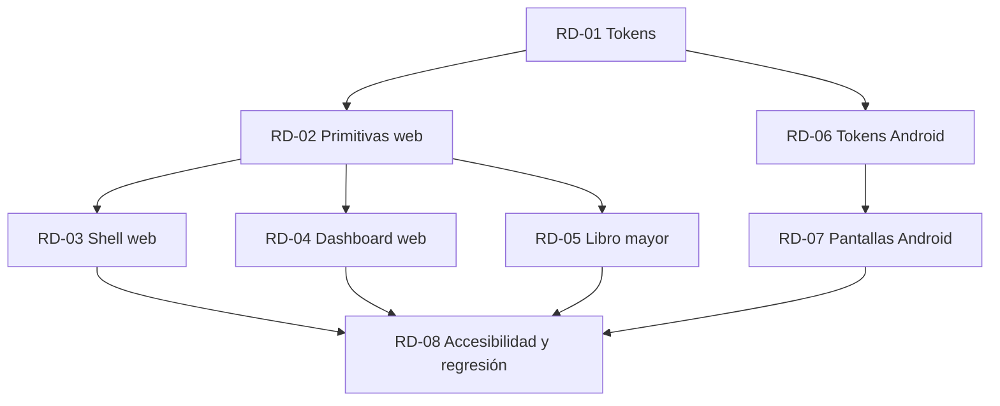

# Plan de rediseño — web y Android

> Epic: **#98** · Issues: **#90–#97**

## 1. Objetivo

Elevar la **calidad percibida** y la **usabilidad** de MyBusiness sin cambiar reglas de negocio, contratos de API ni modelo de datos. Se persigue:

- Reducir deuda visual: primitivas duplicadas, estilos ad hoc, hex sueltos.
- Unificar el lenguaje visual entre `apps/web` y `apps/mobile-android`.
- Hacer verificable la calidad de UI (tokens, contraste, estados, accesibilidad).

Criterio de éxito: `docs/design/DESIGN-RULES.md` aplicado de forma consistente y comprobable en CI.

## 2. Alcance

**Dentro:**

- `apps/web`: login, shell de navegación, dashboard, libro mayor y los paneles futuros de agente/PayPal (solo su contenedor visual).
- `apps/mobile-android`: login, dashboard y cuentas bancarias.

**Fuera:**

- Lógica de negocio, cálculos financieros y contratos (`packages/contracts`).
- Nuevos features o pantallas no existentes.
- White-label / multi-marca / theming por tenant.
- Rediseño de correos transaccionales.

## 3. Diagnóstico actual

Revisión de `apps/web/app/globals.css`, `apps/web/components/**`, `apps/mobile-android/core/designsystem/**` y `apps/mobile-android/feature/**/ui/**`:

1. **Tokens incompletos.** `globals.css` cubre color, tipografía, un `--spacing` único y tres radios. No hay escala semántica de espaciado, ni tokens de elevación, ni de movimiento (duraciones/easings), ni `focus-ring` como rol propio.
2. **Primitivas duplicadas.** `dashboard/` y `ledger/` reimplementan botones, chips, inputs y tarjetas. `ledger-filters.tsx` exporta `INPUT_CLASS`/`BUTTON_CLASS` como constantes de string: no son componentes, no admiten estados ni tests.
3. **Estados desiguales.** El dashboard tiene `empty-state.tsx` y `error-state.tsx`; el libro mayor resuelve lo mismo con condicionales internos. No existe un contrato común de `loading`/`empty`/`error`/`unauthorized`/`success`.
4. **Targets pequeños.** Iconos de acción (orden, cerrar, copiar, toggle de tema) sin área táctil garantizada de 44×44 px; checkboxes de 16 px sin label ampliado.
5. **Sin escala de espaciado.** Se usan utilidades arbitrarias (`gap-3`, `p-5`, `mt-7`) sin ritmo definido; no hay token de spacing por rol.
6. **Android parcialmente alineado.** `Theme.kt` define `Color/Type/Shape`, pero los colores semánticos financieros (`SuccessGreen`, `ErrorRed`) viven como `val` sueltos fuera del `ColorScheme`, se consumen con `copy(alpha = 0.15f)` y no existen roles `income`/`expense`/`alert`. Además `ErrorRed` no tiene par oscuro propio y el espaciado se escribe con `.dp` ad hoc.
7. **Sin regresión visual.** No hay capturas base ni job de comparación; los cambios de UI se validan a ojo.
8. **Sin checklist de diseño en PR.** No existe plantilla que exija capturas, `axe` ni estados por pantalla.

## 4. Olas de trabajo

### Ola 1 — Fundaciones

Unifica la base antes de tocar pantallas. Sin esta ola, las siguientes multiplican la deuda.

- **RD-01** Auditoría UI y contrato de tokens.
- **RD-02** Primitivas de UI accesibles (web).
- **RD-06** Tokens y tema (Android).

### Ola 2 — Pantallas

Reescribe las superficies sobre las primitivas y tokens de la Ola 1.

- **RD-03** Shell y navegación web.
- **RD-04** Dashboard web.
- **RD-05** Libro mayor y formularios.
- **RD-07** Pantallas clave Android.

### Ola 3 — Calidad

Cierra el ciclo con verificación automatizada y proceso.

- **RD-08** Accesibilidad y regresión visual.

## 5. Issues

| ID    | Título                                       | Labels                      | SP  | Depende de                        | Entregable verificable                                                                                                                     | GitHub |
| ----- | -------------------------------------------- | --------------------------- | --- | --------------------------------- | ------------------------------------------------------------------------------------------------------------------------------------------ | ------ |
| RD-01 | `[Design]` Auditoría UI y contrato de tokens | `design`, `ux`, `redesign`  | 5   | —                                 | `docs/design/tokens.md` con jerarquía global→semántico→componente, inventario de usos actuales y script de contraste ejecutable            | #90    |
| RD-02 | `[Web]` Primitivas de UI accesibles          | `design`, `web`, `frontend` | 8   | RD-01                             | `Button`, `IconButton`, `Field`, `Select`, `Card`, `Chip`, `Dialog`, `Table shell`, `Skeleton`, `EmptyState` con todos sus estados y tests | #91    |
| RD-03 | `[Web]` Shell y navegación                   | `ux`, `web`                 | 5   | RD-02                             | Trunk test aprobado, drawer móvil, migas de pan y búsqueda/atajo                                                                           | #92    |
| RD-04 | `[Web]` Dashboard                            | `ux`, `web`                 | 5   | RD-02                             | Jerarquía de KPIs, los 5 estados y `prefers-reduced-motion` respetado                                                                      | #93    |
| RD-05 | `[Web]` Libro mayor y formularios            | `ux`, `web`                 | 8   | RD-02                             | Densidad conmutable, tabla sticky, edición inline con feedback y operable por teclado                                                      | #94    |
| RD-06 | `[Android]` Tokens y tema                    | `design`, `mobile`          | 5   | RD-01                             | Paridad de tokens con web, dark theme completo y tipografía alineada                                                                       | #95    |
| RD-07 | `[Android]` Pantallas clave                  | `ux`, `mobile`              | 8   | RD-06                             | Login, dashboard y bancos con los 5 estados, targets de 48 dp y motion                                                                     | #96    |
| RD-08 | `[QA]` Accesibilidad y regresión visual      | `qa`, `accessibility`       | 5   | RD-03, RD-04, RD-05, RD-06, RD-07 | `axe` en CI, capturas base versionadas y checklist TalkBack                                                                                | #97    |

**Total: 49 SP.**

Notas de estimación: 1 SP ≈ media jornada de un desarrollador con el contexto del repo. Los SP incluyen tests y capturas, no solo implementación.

## 6. Criterios de salida

El rediseño se considera terminado cuando:

- `axe` reporta **0 violaciones críticas** en todas las rutas de web.
- Contraste y targets se verifican **automáticamente** (script de tokens + test de tamaños), no a ojo.
- **Todas** las pantallas del alcance tienen los 5 estados implementados y demostrables.
- Existe **paridad de tokens** entre web y Android: los mismos roles con los mismos valores semánticos.
- El checklist de `DESIGN-RULES.md` §7 se ha aplicado en **≥ 3 PRs** reales.

## 7. Riesgos

| Riesgo                                           | Impacto                                  | Mitigación                                                                                                          |
| ------------------------------------------------ | ---------------------------------------- | ------------------------------------------------------------------------------------------------------------------- |
| Colisión con features de Fase 3 (agente, PayPal) | Retrabajo y conflictos de merge          | Olas cerradas; el rediseño no toca lógica ni contratos; los features nuevos nacen ya usando las primitivas de RD-02 |
| Regresiones funcionales al tocar pantallas       | Pérdida de confianza, bugs en producción | Capturas base + tests de componente + revisión cruzada; cambios de UI en PRs pequeños                               |
| Scope creep (aprovechar para "mejorar" features) | El plan no cierra                        | Checklist de alcance congelado: todo lo que no esté en la tabla de issues se abre como issue aparte                 |
| Divergencia web/Android                          | Se pierde el objetivo de unificación     | RD-01 define el contrato de tokens una sola vez; RD-06 lo consume                                                   |

## 8. Gobernanza

- **Owner de diseño:** JuanchR4. Es quien prioriza, revisa y aprueba los entregables de la tabla.
- **Revisión cruzada:** Umbrex47 revisa los PRs de UI (segundo par de ojos obligatorio, ver `DESIGN-RULES.md` §8).
- **Cambios de reglas:** cualquier regla nueva se añade **primero** al LLM Wiki (`~/wiki/patterns/web-design-core-principles.md` o la nota correspondiente) y solo después se incorpora a `docs/design/DESIGN-RULES.md`.
- **Trazabilidad:** cada PR de UI referencia su `RD-xx` y pega el checklist firmado.

## Fichas de issue

## RD-01 — [Design] Auditoría UI y contrato de tokens

**Labels:** `design`, `ux`, `redesign`
**Owner:** JuanchR4 · **SP:** 5 · **Depende de:** —

### Contexto

`globals.css` cubre color y tipografía, pero no hay escala semántica de espaciado, elevación ni movimiento; los hex y utilidades arbitrarias se repiten por componente. Android define `Theme.kt` de forma parcial y con colores financieros fuera del `ColorScheme`. Sin un contrato único, cada ola reintroduce deuda.

### Alcance

- Inventario de pantallas y componentes de `apps/web` y `apps/mobile-android` con los tokens y hardcodes en uso.
- Contrato en `docs/design/tokens.md`: capas global → semántica → componente, roles (`surface`, `border`, `text-muted`, `focus-ring`, `income`, `expense`, `alert`), variantes light/dark, escala de spacing 4/8, radios, tipografía y motion (duraciones/easings).
- Script `scripts/design/check-contrast.mjs` que lea los tokens y valide 4.5:1 en texto y 3:1 en UI/iconos.
- Tabla de correspondencia web ↔ Android.

### Fuera de alcance

- Implementar componentes o temas (RD-02 y RD-06).
- Cambiar valores de marca ya aprobados.

### Criterios de aceptación

- [ ] `docs/design/tokens.md` documenta las tres capas con nombre, valor, rol y uso.
- [ ] Todo par texto/fondo del contrato cumple 4.5:1 y todo borde/icono 3:1 en light y dark.
- [ ] La escala de spacing es 4/8 y ningún token usa valores fuera de ella.
- [ ] La tabla web ↔ Android mapea cada rol semántico a su equivalente en `core/designsystem`.
- [ ] El inventario lista los hardcodes detectados con archivo y línea, y su token destino.
- [ ] `check-contrast.mjs` falla con exit code ≠ 0 si un par incumple el umbral.

### Validación

```bash
node scripts/design/check-contrast.mjs
pnpm lint
```

## RD-02 — [Web] Primitivas de UI accesibles

**Labels:** `design`, `web`, `frontend`
**Owner:** JuanchR4 · **SP:** 8 · **Depende de:** RD-01

### Contexto

`dashboard/` y `ledger/` reimplementan botones, chips, inputs y tarjetas; `ledger-filters.tsx` exporta clases como constantes. No hay estados uniformes ni tests de accesibilidad, y varios iconos no garantizan 44×44 px.

### Alcance

- `apps/web/components/ui/`: `Button`, `IconButton`, `Field`, `Select`, `Card`, `Chip`/`StatusBadge`, `Dialog`, shell de `Table`, `Skeleton`, `EmptyState`, `InlineBanner`.
- Estados hover, active, focus-visible, disabled y loading; targets mínimos de 44 px; `aria-*` correctos; solo tokens semánticos.

### Fuera de alcance

- Reescribir pantallas completas (RD-03/04/05).
- Nuevos patrones de interacción no cubiertos por `DESIGN-RULES.md`.

### Criterios de aceptación

- [ ] Cada primitiva expone y demuestra los cinco estados en su story o test.
- [ ] Ningún archivo de `components/ui/` contiene valores hex ni utilidades arbitrarias de spacing.
- [ ] Todo control interactivo tiene área táctil ≥ 44×44 px verificada por test.
- [ ] `Dialog` atrapa el foco, cierra con `Escape` y restaura el foco al disparador.
- [ ] Vitest cubre render y estados; Playwright + `axe` reporta 0 violaciones en la página de muestra.
- [ ] `pnpm --filter @mybusiness/web build` compila sin warnings de tipos.

### Validación

```bash
pnpm --filter @mybusiness/web test:unit
pnpm --filter @mybusiness/web test
pnpm --filter @mybusiness/web build
```

## RD-03 — [Web] Shell y navegación

**Labels:** `ux`, `web`
**Owner:** JuanchR4 · **SP:** 5 · **Depende de:** RD-02

### Contexto

El shell actual no garantiza el trunk test: el logo no siempre vuelve a `/`, no hay `h1` único por página ni migas, y el estado activo depende de comparaciones frágiles. En móvil el menú no gestiona foco ni `Escape`.

### Alcance

- Shell con logo → `/`, un `h1` por página, migas de pan, ítem activo accesible y skip link.
- Drawer móvil con focus trap, cierre con `Escape` y retorno de foco.
- Búsqueda con atajo `/` o `⌘K` sin romper rutas existentes.

### Fuera de alcance

- Contenido de dashboard y libro mayor.
- Búsqueda semántica o backend de búsqueda.

### Criterios de aceptación

- [ ] El trunk test pasa: desde cualquier ruta se llega a la raíz en un clic y cada página tiene un solo `h1`.
- [ ] Las migas reflejan la jerarquía y el ítem activo usa `aria-current="page"`.
- [ ] El skip link es el primer elemento focuseable y salta al contenido principal.
- [ ] El drawer atrapa el foco, cierra con `Escape` y devuelve el foco al botón que lo abrió.
- [ ] El atajo de búsqueda funciona en todas las rutas y no intercepta la escritura en inputs.
- [ ] E2E de teclado y `axe` en el shell reportan 0 violaciones.

### Validación

```bash
pnpm --filter @mybusiness/web test
```

## RD-04 — [Web] Dashboard

**Labels:** `ux`, `web`
**Owner:** JuanchR4 · **SP:** 5 · **Depende de:** RD-02

### Contexto

El dashboard mezcla KPIs sin jerarquía, resuelve estados con condicionales dispersos y el gráfico no ofrece alternativa textual. No se respeta `prefers-reduced-motion`.

### Alcance

- KPI primario (saldo) y secundarios con jerarquía de tres niveles.
- Estados empty, loading, error y success homogéneos.
- Skeletons ≤ 300 ms, respeto a `prefers-reduced-motion` y tabla accesible equivalente al gráfico.

### Fuera de alcance

- Cálculos financieros o nuevas métricas.
- Paneles de agente/PayPal más allá de su contenedor.

### Criterios de aceptación

- [ ] Existe un único KPI primario visualmente dominante y los secundarios quedan subordinados.
- [ ] Los cuatro estados son demostrables y usan las primitivas de RD-02.
- [ ] Los skeletons aparecen solo tras 300 ms y no parpadean en cargas rápidas.
- [ ] Con `prefers-reduced-motion` no hay animaciones no esenciales.
- [ ] El gráfico tiene tabla o resumen accesible con los mismos datos.
- [ ] E2E de los cuatro estados y `axe` reportan 0 violaciones.

### Validación

```bash
pnpm --filter @mybusiness/web test
```

## RD-05 — [Web] Libro mayor y formularios

**Labels:** `ux`, `web`
**Owner:** JuanchR4 · **SP:** 8 · **Depende de:** RD-02

### Contexto

El libro mayor usa clases sueltas para inputs y botones, no tiene cabecera sticky ni densidad conmutable, y la edición inline pierde datos ante error. No hay atajos de teclado.

### Alcance

- Densidad cómoda/compacta, cabecera sticky y columnas prioritarias.
- Alineación numérica, barra de selección persistente y edición inline con feedback y rollback.
- Validación inline que conserva datos y atajos `j`/`k`, `Enter`, `Escape`.

### Fuera de alcance

- Reglas contables, filtros de backend y exportaciones.
- Edición por lotes fuera de la selección visible.

### Criterios de aceptación

- [ ] La densidad se conmuta sin perder selección ni scroll.
- [ ] La cabecera permanece visible al hacer scroll y las columnas prioritarias no se ocultan.
- [ ] Los importes se alinean a la derecha con cifras tabulares.
- [ ] La edición inline muestra feedback, y ante error revierte al valor previo sin cerrar el editor.
- [ ] La validación inline conserva lo escrito y anuncia el error con `aria-describedby`.
- [ ] `j`/`k`, `Enter` y `Escape` funcionan, y E2E de teclado + `axe` reportan 0 violaciones.

### Validación

```bash
pnpm --filter @mybusiness/web test
```

## RD-06 — [Android] Tokens y tema

**Labels:** `design`, `mobile`
**Owner:** JuanchR4 · **SP:** 5 · **Depende de:** RD-01

### Contexto

`core/designsystem` define `Color/Type/Shape` de forma parcial: `SuccessGreen` y `ErrorRed` viven fuera del `ColorScheme`, no hay roles `income`/`expense`/`alert`, `ErrorRed` carece de par oscuro y el espaciado se escribe con `.dp` ad hoc.

### Alcance

- Tokens y tema en `apps/mobile-android/core/designsystem`: roles M3, spacing, shape, type scale y motion.
- Dark theme completo con `SuccessGreen`/`ErrorRed` dentro del `ColorScheme`.
- Contraste calculado en tests unitarios.

### Fuera de alcance

- Rediseño de pantallas (RD-07).
- Componentes nuevos fuera del sistema de diseño.

### Criterios de aceptación

- [ ] Los roles M3 cubren `income`, `expense` y `alert` en light y dark.
- [ ] `SuccessGreen` y `ErrorRed` son parte del `ColorScheme`, sin `val` sueltos.
- [ ] Ni el tema ni los componentes usan colores con `copy(alpha = ...)` como sustituto de rol.
- [ ] Spacing, shape, type scale y motion coinciden con la tabla de paridad de RD-01.
- [ ] Los tests calculan contraste y fallan si baja de 4.5:1 o 3:1.
- [ ] El módulo compila y `:app:assembleDebug` pasa.

### Validación

```bash
cd apps/mobile-android
./gradlew :core:designsystem:testDebugUnitTest :app:assembleDebug
```

## RD-07 — [Android] Pantallas clave

**Labels:** `ux`, `mobile`
**Owner:** JuanchR4 · **SP:** 8 · **Depende de:** RD-06

### Contexto

Login, dashboard y bancos no cubren los cinco estados, usan targets menores de 48 dp, muestran copy técnico y la biometría no tiene affordance clara. `lastSyncedAt` no es legible y el motion ignora reduced-motion.

### Alcance

- Login, dashboard y bancos con estados empty, loading, error, unauthorized y success.
- Targets de 48 dp, copy sin jerga, affordance de biometría y `lastSyncedAt` legible.
- Motion respetando la preferencia de animaciones reducidas.

### Fuera de alcance

- Nuevas pantallas o flujos.
- Cambios en autenticación biométrica más allá de la UI.

### Criterios de aceptación

- [ ] Las tres pantallas demuestran los cinco estados.
- [ ] Todo control interactivo mide ≥ 48 dp y lo verifica un test.
- [ ] El copy no contiene términos técnicos ni códigos de error crudos.
- [ ] La biometría se ofrece de forma explícita y cancelable.
- [ ] `lastSyncedAt` se muestra en formato relativo legible.
- [ ] Con animaciones reducidas no hay transiciones no esenciales.

### Validación

```bash
cd apps/mobile-android
./gradlew :app:testDebugUnitTest :app:assembleDebug
```

Checklist manual en emulador: estados, biometría, rotación y TalkBack.

## RD-08 — [QA] Accesibilidad y regresión visual

**Labels:** `qa`, `accessibility`
**Owner:** JuanchR4 · **SP:** 5 · **Depende de:** RD-03, RD-04, RD-05, RD-06, RD-07

### Contexto

No hay job de `axe`, ni capturas base, ni verificación de contraste en CI. Los cambios de UI se validan a ojo y las regresiones pasan desapercibidas.

### Alcance

- `axe` en Playwright para todas las rutas de `apps/web`.
- Capturas base claro/oscuro/móvil con umbral de diferencias.
- Checklist TalkBack y contraste dentro de CI.

### Fuera de alcance

- Corregir violaciones de producto (se abren como issues enlazadas).
- Pruebas en dispositivos físicos iOS.

### Criterios de aceptación

- [ ] `axe` corre en todas las rutas y falla el pipeline con violaciones críticas.
- [ ] Existen capturas base versionadas para claro, oscuro y móvil.
- [ ] La comparación visual falla por encima del umbral definido y publica el diff.
- [ ] `check-contrast.mjs` se ejecuta en CI y bloquea el merge si falla.
- [ ] El checklist TalkBack está documentado y firmado en al menos un PR.
- [ ] El job es reproducible en local con los mismos comandos.

### Validación

```bash
pnpm --filter @mybusiness/web test
node scripts/design/check-contrast.mjs
```

## Dependencias


