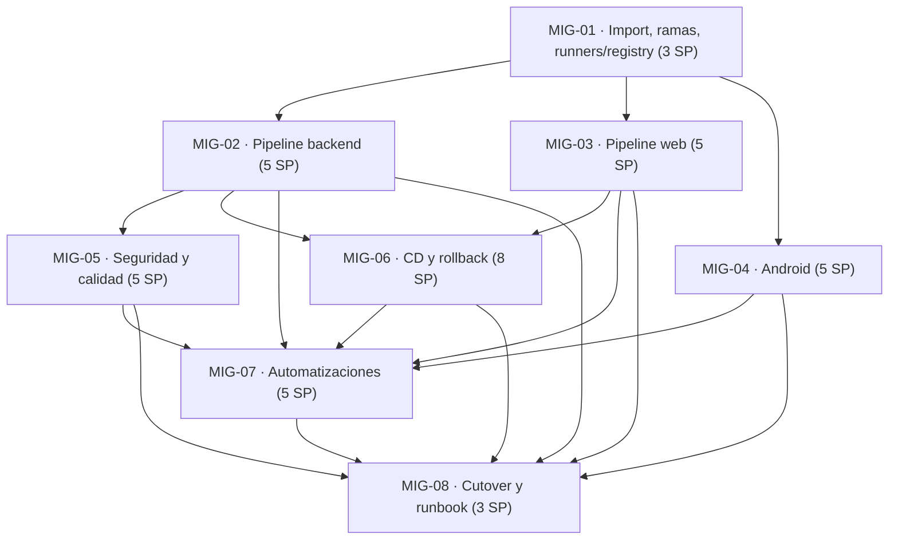

# Issues — Migración de CI/CD a GitLab

> Documento fuente del alcance de la migración descrita en [`README.md`](./README.md).
> Las issues de seguimiento viven en GitHub (ver columna `GitHub`) y se replicarán en el proyecto
> GitLab de destino durante la fase 1.
> Convención de ID: `MIG-NN`.

> Epic: **#142** · Issues: **#134–#141**

## Resumen

| ID     | Título                                                                       | Labels                            | Owner    | SP  | Depende de      | GitHub |
| ------ | ---------------------------------------------------------------------------- | --------------------------------- | -------- | --- | --------------- | ------ |
| MIG-01 | [CI/CD] Importar repositorio, proteger ramas y decidir runners/registry      | `migration`, `devops`             | Umbrex47 | 3   | —               | #134   |
| MIG-02 | [CI/CD] Pipeline base backend                                                | `migration`, `devops`, `backend`  | Umbrex47 | 5   | MIG-01          | #135   |
| MIG-03 | [CI/CD] Pipeline web (calidad, Playwright, a11y, visual)                     | `migration`, `devops`, `web`      | Umbrex47 | 5   | MIG-01          | #136   |
| MIG-04 | [CI/CD] Runner Android y pipeline Gradle                                     | `migration`, `devops`, `mobile`   | JuanchR4 | 5   | MIG-01          | #137   |
| MIG-05 | [CI/CD] Seguridad y calidad en GitLab                                        | `migration`, `security`, `devops` | Umbrex47 | 5   | MIG-02          | #138   |
| MIG-06 | [CI/CD] CD con Container Registry, staging/producción y rollback             | `migration`, `devops`             | Umbrex47 | 8   | MIG-02, MIG-03  | #139   |
| MIG-07 | [CI/CD] Automatizaciones: schedules, Renovate, merge trains y notificaciones | `migration`, `devops`             | Umbrex47 | 5   | MIG-02 … MIG-06 | #140   |
| MIG-08 | [CI/CD] Cutover, espejo y runbook                                            | `migration`, `devops`             | Umbrex47 | 3   | MIG-02 … MIG-07 | #141   |

Total: **39 SP**.

---

## MIG-01 — [CI/CD] Importar repositorio, proteger ramas y decidir runners/registry

**Labels:** `migration`, `devops`
**Owner:** Umbrex47 · **SP:** 3 · **Depende de:** —

### Contexto

Todo lo demás depende de que exista el proyecto en GitLab con el historial completo, la rama por
defecto correcta y las protecciones equivalentes a las de GitHub. Sin estas decisiones cerradas, cada
issue posterior tomaría criterios distintos sobre imágenes, runners y secretos.

### Alcance

- Importar `CoffeLovers/mybusiness` con historial completo (espejo de `main`, `develop` y tags).
- Fijar `develop` como rama por defecto y `main` como espejo protegido **ff-only**.
- Proteger `develop`: sin force-push, sin borrado, merge solo con pipeline verde.
- Inventariar secretos y variables de GitHub (`SONAR_TOKEN`, `STAGING_*`, `PRODUCTION_*`) y mapearlos
  a variables masked/protected/file según `README.md` §6.
- Redactar el ADR de CI/CD con la decisión de plataforma (GitLab.com), runners (Linux Docker + runner
  propio para Android) y registry (GitLab Container Registry).
- Dejar un `.gitlab-ci.yml` mínimo (stage `validate` con `backend:lint`) que pase en un MR de prueba.

### Fuera de alcance

- Implementar el resto de jobs (MIG-02 a MIG-06).
- Migrar issues o MRs históricos.
- Rotar secretos de producción (ocurre en MIG-08).

### Criterios de aceptación

- [ ] El proyecto existe en GitLab con todos los commits de `main` y `develop` y los tags.
- [ ] `develop` es la rama por defecto y está protegida (no force-push, sin borrado, pipeline verde obligatorio).
- [ ] `main` está protegida y solo acepta fast-forward desde `develop`.
- [ ] El ADR está en `docs/adr/` y nombra explícitamente plataforma, runners y registry.
- [ ] Existe la tabla de secretos con tipo, protección y entorno de cada uno.
- [ ] Un MR de prueba dispara el pipeline mínimo y queda verde.
- [ ] Ningún secreto está en el repositorio ni en el YAML.

### Validación

- `git rev-parse main develop` en GitHub y GitLab devuelve los mismos SHA.
- MR de prueba en GitLab: pipeline verde y merge bloqueado al introducir un fallo de lint.
- Revisión del ADR por un segundo maintainer.

---

## MIG-02 — [CI/CD] Pipeline base backend

**Labels:** `migration`, `devops`, `backend`
**Owner:** Umbrex47 · **SP:** 5 · **Depende de:** MIG-01

### Contexto

`ci.yml` es la red de seguridad del monorepo: 7 jobs que hoy bloquean cualquier merge. La paridad de
este workflow es la condición para poder apagar Actions sin perder cobertura.

### Alcance

- Jobs `backend:lint`, `backend:format`, `backend:typecheck`, `backend:test`, `backend:contracts`,
  `backend:build` y `backend:e2e` con los mismos comandos que `ci.yml`.
- Cache de pnpm con `key: files: [pnpm-lock.yaml]` sobre `.pnpm-store` y `store-dir` explícito.
- `backend:e2e` con cuatro `services` (Postgres finance, pgvector agent, Postgres audit y Redis 7),
  alias de red y espera activa de salud antes de migrar.
- Variables de base de datos apuntando a `postgres`, `postgres-agent`, `postgres-audit` y `redis`
  (nunca `127.0.0.1`).
- `needs` equivalentes al DAG de GitHub y artefactos de cobertura y JUnit.
- `.node` en `.gitlab/ci/base.yml` con corepack y pnpm 12.9.1.

### Fuera de alcance

- Jobs de web, Android, seguridad y despliegue.
- Cambios en los comandos de test o en la configuración de Jest/TypeScript.
- Migración de la cobertura a otro proveedor.

### Criterios de aceptación

- [ ] Los 7 jobs existen y ejecutan exactamente los comandos de `ci.yml`.
- [ ] `backend:e2e` pasa con los cuatro servicios resueltos por alias y sin `localhost`.
- [ ] La espera de servicios falla con mensaje claro si un contenedor no arranca.
- [ ] `backend:contracts` publica el diff de drift cuando falla.
- [ ] La segunda ejecución del pipeline reutiliza la cache de pnpm (tiempo de instalación menor).
- [ ] Un fallo en `backend:test` bloquea el merge del MR.

### Validación

- MR con un test roto: pipeline rojo y merge bloqueado; se restaura y queda verde.
- Log de `backend:e2e` mostrando `pg_isready` OK en los tres Postgres y `PONG` en Redis.
- Tiempos de la primera y la segunda ejecución comparados en el job de `backend:test`.

---

## MIG-03 — [CI/CD] Pipeline web (calidad, Playwright, a11y, visual)

**Labels:** `migration`, `devops`, `web`
**Owner:** Umbrex47 · **SP:** 5 · **Depende de:** MIG-01

### Contexto

`web-ci.yml` protege el portal Next.js con cinco jobs: calidad, contratos, E2E con Playwright, a11y
con axe y seguridad de imagen. Su disparo es selectivo por `paths`, y esa selectividad debe replicarse
para no gastar minutos en cada MR de backend.

### Alcance

- Jobs `web:quality`, `web:contracts`, `web:e2e`, `web:a11y` con los comandos actuales.
- `rules:changes` con las mismas rutas que `paths` de GitHub, incluyendo `apps/api-gateway/**`,
  `packages/{contracts,common}/**`, `docs/openapi/**`, `docs/design/**`, `scripts/**` y el lockfile.
- Cache de pnpm y de `apps/web/.next/cache`.
- Chromium vía imagen oficial de Playwright o `playwright install --with-deps chromium`, con la
  versión alineada a `@playwright/test`.
- Artefactos: `junit.xml`, `apps/web/coverage/lcov.info`, `playwright-report`, `test-results` y los
  `*-diff.png` / `*-actual.png` / `*-expected.png`.
- `timeout` de 10 min en calidad/contratos y 15 min en E2E/a11y.

### Fuera de alcance

- `web:sonar` y `web:trivy-image` (MIG-05).
- Cambios en las pruebas E2E o en los snapshots visuales.
- `deploy:staging` (MIG-06).

### Criterios de aceptación

- [ ] `web:quality` ejecuta lint, Prettier, contraste, typecheck, cobertura y build.
- [ ] `web:e2e` publica `junit.xml` como reporte y el fallo se ve test a test en GitLab.
- [ ] Los diffs visuales se descargan como artefacto cuando el job falla.
- [ ] Un MR que solo toca `apps/web/**` dispara los jobs web; uno que solo toca backend no.
- [ ] `web:a11y` ejecuta `accessibility.spec.ts` con Chromium instalado.
- [ ] El cache de Next.js reduce el tiempo de `web:quality` en la segunda ejecución.

### Validación

- MR con cambio en `apps/web` y MR con cambio en `apps/api-gateway`: comparar los pipelines disparados.
- Forzar un fallo de snapshot y comprobar que `*-diff.png` está en los artefactos descargables.

---

## MIG-04 — [CI/CD] Runner Android y pipeline Gradle

**Labels:** `migration`, `devops`, `mobile`
**Owner:** JuanchR4 · **SP:** 5 · **Depende de:** MIG-01

### Contexto

El job Android es el más caro del repo (JDK 17, Gradle, unit tests y `assembleDebug`, 30 min de
presupuesto) y los shared runners no garantizan ni imagen con SDK 35 ni disco ni minutos. Necesita
runner e imagen propios antes de poder ser bloqueante.

### Alcance

- Runner Docker self-hosted etiquetado `heavy` (8 vCPU / 16 GB / 200 GB) o imagen dedicada en runners
  del proyecto.
- Imagen con JDK 17 (temurin), `cmdline-tools`, `platforms;android-35`, `build-tools;35.0.0` y
  `platform-tools`.
- Job `android:build` con `working-directory` efectivo en `apps/mobile-android`, `chmod +x gradlew` y
  el mismo comando Gradle (`:core:designsystem:testDebugUnitTest`, `:core:common:testDebugUnitTest`,
  `:app:testDebugUnitTest`, `:app:assembleDebug`).
- Cache de Gradle (`GRADLE_USER_HOME`) con clave por `gradle-wrapper.properties` y `build.gradle.kts`.
- Artefacto del APK y de los reportes de test; `timeout: 30m`; `resource_group: android`.
- `rules:changes` limitado a `apps/mobile-android/**` y al propio archivo de CI.

### Fuera de alcance

- Tests instrumentados o emulador (no existen en el pipeline actual).
- Firma de release o publicación en Play Store.
- Cambios en `build.gradle.kts` más allá de lo necesario para cachear.

### Criterios de aceptación

- [ ] El runner `heavy` está registrado y solo acepta jobs con ese tag.
- [ ] La imagen contiene JDK 17 y SDK 35 verificables (`java -version`, `sdkmanager --list_installed`).
- [ ] `android:build` termina en menos de 25 min en caliente y publica el APK debug.
- [ ] Los reportes de test unitario se muestran como `reports:junit` en GitLab.
- [ ] El job se salta en MRs que no tocan `apps/mobile-android/**`.
- [ ] Un fallo de test unitario bloquea el merge.

### Validación

- Dos ejecuciones consecutivas del job: la segunda debe ser sensiblemente más rápida por cache.
- Descargar el APK desde los artefactos y comprobar `aapt dump badging` (package y versión).

---

## MIG-05 — [CI/CD] Seguridad y calidad en GitLab

**Labels:** `migration`, `security`, `devops`
**Owner:** Umbrex47 · **SP:** 5 · **Depende de:** MIG-02

### Contexto

Hoy `security.yml` y `web-ci.yml` cubren Trivy filesystem, Trivy de imagen y SonarCloud. En GitLab
hay que conservar esos tres controles con los mismos umbrales y añadir los analizadores nativos sin
duplicar ruido ni romper la paridad de hallazgos.

### Alcance

- `security:trivy-fs` en SARIF como `reports:sast` y artefacto descargable.
- `web:trivy-image`: build de `apps/web/Dockerfile` y Trivy bloqueante en `CRITICAL,HIGH` con
  `ignore-unfixed`, más SARIF no bloqueante.
- `backend:sonar` y `web:sonar` con `sonarsource/sonar-scanner-cli` y `SONAR_TOKEN` protegido,
  reutilizando project key `CoffeLovers_mybusiness` y organización `coffeelovers`.
- Activar SAST, Dependency Scanning y Container Scanning de las plantillas de GitLab.
- Publicar SARIF como artefacto y aplicar el quality gate de Sonar como condición de merge.

### Fuera de alcance

- Migrar a SonarQube self-managed.
- Resolver los hallazgos existentes (se documentan y se abren issues aparte si son nuevos).
- Escaneo dinámico (DAST) sobre staging.

### Criterios de aceptación

- [ ] `security:trivy-fs` produce SARIF y aparece en la pestaña de seguridad del proyecto.
- [ ] `web:trivy-image` falla con un CVE `CRITICAL` no corregible y pasa con `ignore-unfixed`.
- [ ] SonarCloud recibe cobertura y el quality gate se refleja en el MR.
- [ ] Los jobs de Sonar se omiten limpiamente si `SONAR_TOKEN` no está definido.
- [ ] SAST, Dependency y Container Scanning están activos con informe visible.
- [ ] El número de hallazgos es igual o menor que el del pipeline de GitHub (o está justificado).

### Validación

- Comparar el dashboard de SonarCloud antes y después (mismo project key, misma cobertura).
- Revisar que `trivy-*.sarif` se descarga desde los artefactos del pipeline.

---

## MIG-06 — [CI/CD] CD con Container Registry, staging/producción y rollback

**Labels:** `migration`, `devops`
**Owner:** Umbrex47 · **SP:** 8 · **Depende de:** MIG-02, MIG-03

### Contexto

`web-cd.yml` construye la imagen, la publica en GHCR y despliega por SSH a staging (automático en
`develop`) y producción (manual en `main`), con smoke y rollback al contenedor anterior. La migración
debe sustituir GHCR por el Container Registry y `environment` de GitHub por `environment` de GitLab,
manteniendo el rollback probado.

### Alcance

- `package:web` con BuildKit (`docker buildx`), cache `type=registry` en `$CI_REGISTRY_IMAGE:cache`,
  tags por SHA y por rama, y push autenticado con `CI_JOB_TOKEN`.
- `deploy:staging` automático en `develop` con `environment: staging`, `url: $STAGING_URL` y
  `resource_group: deploy/staging`.
- `deploy:production` manual en `main` con `environment: production` y aprobación.
- Script SSH equivalente al de `appleboy/ssh-action`: pull, guardar imagen anterior, recrear el
  contenedor (`mybusiness-web` en 3000, `mybusiness-web-prod` en 3001), smoke `/healthz` con 30 s de
  espera y rollback a la imagen anterior si falla.
- Smoke externo `/healthz` y `/login` (200) después del deploy.
- Secretos SSH como variables **File** y `retry` para fallos de red.

### Fuera de alcance

- Cambiar de orquestador (sigue siendo Docker en el host, no Kubernetes).
- Cambiar hosts, puertos o el Dockerfile.
- Blue/green o canary deploy.
- Review apps (MIG-07).

### Criterios de aceptación

- [ ] `package:web` publica en `$CI_REGISTRY_IMAGE/web` con tags `$CI_COMMIT_SHA` y `$CI_COMMIT_REF_SLUG`.
- [ ] La cache de BuildKit reduce el build a menos de la mitad en la segunda ejecución.
- [ ] Un merge a `develop` despliega a staging sin intervención y el smoke externo pasa.
- [ ] `deploy:production` solo corre en `main` y exige aprobación manual.
- [ ] Forzar un smoke fallido en staging restaura la imagen anterior y el job queda rojo.
- [ ] Ningún secreto aparece en el log; la clave SSH se usa desde un archivo con permisos 0400.

### Validación

- Deploy real a staging desde `develop` y comprobación de `/healthz` y `/login`.
- Rollback provocado (imagen con healthcheck roto en una rama de prueba) y verificación del contenedor
  restaurado con `docker inspect --format '{{.Config.Image}}'`.

---

## MIG-07 — [CI/CD] Automatizaciones: schedules, Renovate, merge trains y notificaciones

**Labels:** `migration`, `devops`
**Owner:** Umbrex47 · **SP:** 5 · **Depende de:** MIG-02, MIG-03, MIG-04, MIG-05, MIG-06

### Contexto

GitHub solo aporta hoy el cron implícito de nada y Dependabot no está configurado; GitLab permite
cerrar esa brecha con costo bajo: E2E nocturno, load test semanal, audit mensual, Renovate, merge
trains y avisos. Sin esta issue el pipeline es equivalente pero no mejor.

### Alcance

- Pipeline schedule nocturno (03:00 UTC) sobre `develop` con E2E backend, E2E web y contratos.
- Schedule semanal del load test (`load:ingest-50k` en modo FULL) y mensual de auditoría de seguridad.
- `renovate.json` con `config:recommended`, agrupación por ecosistema y MRs contra `develop`.
- Merge trains en `develop` y auto-merge para MRs de Renovate y `docs/*` con pipeline verde.
- Releases por tag `v*` con `release-cli`.
- Job `notify` (`when: always`) a Slack y, para producción, a Telegram.
- `interruptible`, `resource_group` y `retry` afinados por job.

### Fuera de alcance

- Review apps con host dedicado (queda documentado como opcional).
- Migrar Dependabot (no existe).
- Alertas de observabilidad de la aplicación.

### Criterios de aceptación

- [ ] El schedule nocturno se ha ejecutado al menos una vez con éxito y es visible en el historial.
- [ ] El load test semanal se ejecuta en FULL y publica `k6-summary.json` y `verification-54.json`.
- [ ] Renovate ha abierto al menos un MR correctamente etiquetado contra `develop`.
- [ ] Merge trains activado y probado con dos MRs verdes consecutivos.
- [ ] Un tag `vX.Y.Z` genera release con notas.
- [ ] El job `notify` entrega el mensaje en Slack (y Telegram en producción).
- [ ] Los pipelines obsoletos de una misma ref se cancelan por `interruptible`.

### Validación

- Ejecutar el schedule manualmente (`Run pipeline`) con `SECURITY_AUDIT=1` y revisar el resultado.
- Crear un tag de prueba y comprobar la release; luego eliminarlo.

---

## MIG-08 — [CI/CD] Cutover, espejo y runbook

**Labels:** `migration`, `devops`
**Owner:** Umbrex47 · **SP:** 3 · **Depende de:** MIG-02, MIG-03, MIG-04, MIG-05, MIG-06, MIG-07

### Contexto

Con la paridad completa, falta el paso más delicado: dejar de depender de GitHub Actions sin perder
historial ni capacidad de revertir. El doble push de dos semanas es la red de seguridad que permite
volver atrás sin force-push sobre `main`.

### Alcance

- Congelación de merges y ventana de cutover comunicada al equipo.
- Espejo final GitHub→GitLab con verificación de SHA en `main`, `develop` y tags.
- Activación de MRs en GitLab y desactivación de Actions (`*.yml` → `*.yml.disabled`).
- Rotación de secretos: claves SSH nuevas por entorno, `SONAR_TOKEN` regenerado, revocación de los
  tokens y claves de GitHub.
- Doble push durante dos semanas con GitLab como fuente de verdad.
- Runbook en `docs/migration/gitlab-ci-cd/README.md` actualizado (estado final, URLs, contactos).
- Verificación de paridad: tabla job a job con evidencia de la última ejecución verde en GitLab.

### Fuera de alcance

- Borrar el repositorio de GitHub (queda como espejo de solo lectura).
- Migrar issues o MRs históricos.
- Cambiar el modelo de ramas de `CONTRIBUTING.md` más allá de sustituir GitHub por GitLab.

### Criterios de aceptación

- [ ] Los SHA de `main`, `develop` y tags coinciden en ambos remotes antes del corte.
- [ ] Los workflows de GitHub están desactivados y el PR que los desactiva está mergeado.
- [ ] Las claves SSH antiguas están revocadas y las nuevas probadas en staging y producción.
- [ ] Dos semanas de doble push sin divergencias ni incidencias.
- [ ] `README.md` refleja el estado final y los enlaces de los runbooks apuntan a GitLab.
- [ ] Existe tabla de paridad job a job con enlace al pipeline verde de cada uno.
- [ ] `CONTRIBUTING.md` menciona GitLab (MRs, pipeline, entornos) y ya no exige `gh pr create`.

### Validación

- `git ls-remote` de ambos remotes comparado por SHA.
- Pipeline completo verde en `develop` y en `main` con todos los jobs de paridad.
- Simulación de reversión documentada y cronometrada (sin ejecutarla en producción).

---

## Dependencias

