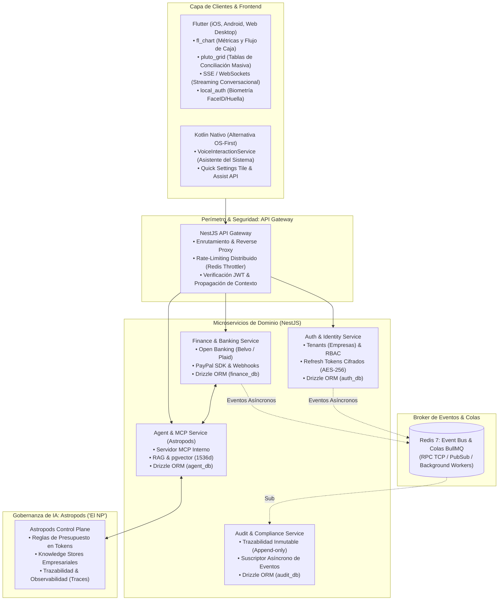

# 💼 Plan Integral de Desarrollo: Asistente Financiero Inteligente (MyBusiness)

> **Plataforma de Asistencia Financiera y Toma de Decisiones para Empresarios y CFOs**  
> Proyecto oficial para el **PayPal AI Hackathon** | Repositorio: [Umbrex47/mybusiness](https://github.com/Umbrex47/mybusiness) | Tablero Kanban: [GitHub Project #7](https://github.com/users/Umbrex47/projects/7)

---

## 1. 🎯 Resumen Ejecutivo y Metas Clave

### Propósito

Desarrollar una plataforma integral de asistencia financiera y toma de decisiones para empresarios y directores financieros (CFOs), simplificando la visualización analítica, habilitando consultas conversacionales en lenguaje natural con soporte reactivo, y transformando transacciones caóticas en un flujo financiero ordenado y automatizado.

### Metas Clave

- **Visualización Intuitiva**: Dashboards de flujo de caja reactivos y tablas analíticas densas para auditoría rápida sin fricción.
- **Consultas en Lenguaje Natural**: Asistente financiero inteligente con streaming en tiempo real y generación dinámica de visualizaciones.
- **Flujo Transaccional Automatizado**: Ingesta continua vía Open Banking, conciliación automática de facturas y cobros vía PayPal sin tareas manuales.

---

## 2. 🏗️ Definición del Stack Tecnológico y Arquitectura



### Backend: NestJS Monorepo Modular

- **Patrón Database-per-Service**: Bases de datos independientes (`auth_db`, `finance_db`, `agent_db`, `audit_db`) sin joins directos entre servicios para garantizar bajo acoplamiento.
- **ORM & Migraciones**: **Drizzle ORM** + `drizzle-kit` ([ADR 001](adr/001-orm-drizzle.md)), garantizando soporte nativo para `pgvector` y tipado estricto inferido.
- **Colas y Tareas Asíncronas**: **BullMQ** respaldado por Redis para procesamiento en segundo plano de webhooks bancarios, OCR y generación de reportes pesados.
- **Protocolo de Agentes**: Servidor **Model Context Protocol (MCP)** interno en NestJS para exponer herramientas financieras de forma desacoplada y auditable.

### Capa de Inteligencia Artificial y Gobernanza: Astropods ('El NP')

- **Control Plane**: Gestión de políticas de gasto en tokens, límites por empresa, memoria compartida empresarial (Knowledge Stores) y trazabilidad completa de inferencias (Traces & Logs).
- **Pods de Agentes**:
  - **Agente 1 (Advisor & Cash Flow)**: Asesor financiero para proyecciones, alertas y análisis de escenarios hipotéticos mediante RAG con `pgvector`.
  - **Agente 2 (Commerce & Payments)**: Automatización de cobros, liquidaciones y conciliación comercial integrando **PayPal AI Toolkit** vía MCP.
  - **Agente 3 (Reconciliation & Audit)**: Conciliador que cruza transacciones bancarias contra facturas extraídas por OCR con matching heurístico.

### Persistencia y Búsqueda Vectorial: PostgreSQL 16 + pgvector

- **Relacional**: Cuentas, usuarios, libros contables, transacciones y bitácora de auditoría inmutable.
- **Vectorial (RAG)**: Embeddings de comprobantes, extractos históricos, políticas fiscales y notas contables (`vector(1536)` con índice HNSW).

### Integraciones Externas

- **Open Banking**: Belvo (Latinoamérica) y Plaid (EE.UU./Global) para sincronización continua de cuentas bancarias y tarjetas corporativas.
- **Extracción de Documentos (OCR)**: Google Cloud Document AI / Mindee para ingesta de facturas y tickets en PDF e imágenes.
- **Pasarela de Pagos**: PayPal Developer SDK (Orders v2 & Webhooks).

---

## 3. 📱 Análisis Frontend: Flutter vs. Kotlin Nativo

| Criterio                         | Flutter (Multiplataforma)                                               | Kotlin Nativo (Android OS First)                                        |
| :------------------------------- | :---------------------------------------------------------------------- | :---------------------------------------------------------------------- |
| **Cobertura de Plataforma**      | iOS, Android, Web y Desktop con 1 solo equipo                           | Solo Android (requiere desarrollo Swift adicional para iOS)             |
| **Tiempo de Desarrollo y Costo** | Rápido (~40% menos esfuerzo)                                            | Mayor tiempo si se requiere soporte multiplataforma                     |
| **Componentes Financieros**      | Ecosistema maduro: `fl_chart` (métricas) y `pluto_grid` (tablas densas) | Construcción a medida con Jetpack Compose                               |
| **Integración con el OS**        | Quick Settings Tiles y Home Screen Widgets vía Platform Channels        | `VoiceInteractionService` (asistente del sistema), Assist API y Bubbles |
| **Streaming & Chat**             | Soporte de Server-Sent Events (SSE) y renderizado reactivo              | Coroutines + Flows nativos                                              |

**Recomendación Estratégica**:  
Para el **PayPal AI Hackathon**, **Flutter** permite desplegar la app en móvil y web simultáneamente, aprovechando `fl_chart` y `pluto_grid` listos para usar, manteniendo los contratos tipados en `packages/contracts`.

---

## 4. 👥 Organización del Equipo (4 Desarrolladores)

| Rol                             | Desarrollador      | Responsabilidades Clave                                                                                                                                                                                                                                                                                 | Issues Vinculados                                                                                                                                                                                                                                                                                                                                                                                                                                        |
| :------------------------------ | :----------------- | :------------------------------------------------------------------------------------------------------------------------------------------------------------------------------------------------------------------------------------------------------------------------------------------------------ | :------------------------------------------------------------------------------------------------------------------------------------------------------------------------------------------------------------------------------------------------------------------------------------------------------------------------------------------------------------------------------------------------------------------------------------------------------- |
| **Backend Lead & Data**         | **Backend Dev 1**  | • Arquitectura del API Gateway, JWT y RBAC.<br>• Modelado relacional con Drizzle ORM y optimización de `pgvector`.<br>• Integración de Open Banking (Belvo/Plaid) y contratos Zod.                                                                                                                      | [#1](https://github.com/Umbrex47/mybusiness/issues/1), [#2](https://github.com/Umbrex47/mybusiness/issues/2), [#3](https://github.com/Umbrex47/mybusiness/issues/3), [#4](https://github.com/Umbrex47/mybusiness/issues/4), [#5](https://github.com/Umbrex47/mybusiness/issues/5), [#6](https://github.com/Umbrex47/mybusiness/issues/6), [#7](https://github.com/Umbrex47/mybusiness/issues/7), [#11](https://github.com/Umbrex47/mybusiness/issues/11) |
| **AI, MCP & Queues**            | **Backend Dev 2**  | • Control plane de Astropods ('El NP') y reglas de gasto.<br>• Servidor MCP en NestJS y PayPal AI Toolkit vía MCP.<br>• Colas BullMQ/Redis para conciliación (Agente 3) e ingesta OCR.<br>• Observabilidad y trazabilidad (Astropods Traces).                                                           | [#2](https://github.com/Umbrex47/mybusiness/issues/2), [#13](https://github.com/Umbrex47/mybusiness/issues/13), [#14](https://github.com/Umbrex47/mybusiness/issues/14), [#15](https://github.com/Umbrex47/mybusiness/issues/15), [#21](https://github.com/Umbrex47/mybusiness/issues/21), [#22](https://github.com/Umbrex47/mybusiness/issues/22)                                                                                                       |
| **Design System & Dashboards**  | **Frontend Dev 1** | • Arquitectura cliente y gestión de estado (BLoC / Riverpod).<br>• Design System accesible (WCAG 2.1 AA) modo claro/oscuro.<br>• Dashboards reactivos con `fl_chart` (Cashflow, Burn rate).<br>• Tablas densas de conciliación masiva con `pluto_grid`.<br>• Autenticación biométrica con `local_auth`. | [#1](https://github.com/Umbrex47/mybusiness/issues/1), [#12](https://github.com/Umbrex47/mybusiness/issues/12), [#13](https://github.com/Umbrex47/mybusiness/issues/13), [#23](https://github.com/Umbrex47/mybusiness/issues/23)                                                                                                                                                                                                                         |
| **Conversational Copilot & OS** | **Frontend Dev 2** | • Módulo de chat financiero con streaming en tiempo real (SSE).<br>• Renderizado dinámico de tarjetas y gráficas dentro del chat.<br>• Integración con el sistema operativo (Quick Settings Tiles / Widgets).<br>• Caché local, modo offline y telemetría de errores (Sentry).                          | [#12](https://github.com/Umbrex47/mybusiness/issues/12), [#22](https://github.com/Umbrex47/mybusiness/issues/22), [#23](https://github.com/Umbrex47/mybusiness/issues/23)                                                                                                                                                                                                                                                                                |

---

## 5. 🗺️ Mapeo de Fases a Issues Existentes (Sin Nuevos Issues)

```
Fase 1: Cimientos de Infraestructura, Seguridad y Modelado de Datos (Sprints 1 y 2)
  ├── Setup Monorepo y microservicios: #1
  ├── PostgreSQL con pgvector y Redis: #2
  ├── Esquema Auth Service (Tenant, User) en Drizzle: #3
  ├── Esquemas Finance, Audit y Agent (pgvector) en Drizzle: #4
  ├── ADRs iniciales (Drizzle, transportes, contratos): #11
  ├── App Base Móvil: #12
  ├── Auth JWT y Refresh Tokens cifrados: #5
  ├── RBAC y propagación Multi-Tenant: #6
  ├── Rate-Limiting distribuido en Gateway: #7
  ├── Pipelines CI/CD en GitHub Actions: #8
  └── Análisis estático SonarQube y Trivy: #9

Fase 2: Ingesta Bancaria, Procesamiento de Facturas y Pipelines Asíncronos
  ├── Lógica de cuentas y transacciones idempotentes: #13
  ├── Memoria vectorial con pgvector y embeddings: #14
  └── Consumidor asíncrono append-only de eventos en Audit Service: #15

Fase 3: Integración de Astropods, Protocolo MCP y PayPal AI
  ├── Integración del SDK de PayPal & Captura de Pagos (Agente 2): #21
  └── Agente Financiero Inteligente con RAG y Astropods (Agente 1): #22

Fase 4: Desarrollo Frontend, Visualización y Chat Copilot
  ├── Implementación de Dashboards (fl_chart) y Conciliación (pluto_grid): #12, #13
  └── Streaming conversacional SSE y acciones de un toque: #12, #22

Fase 5: Pruebas, Guardrails de IA y Auditoría de Seguridad
  ├── Pruebas de integración, carga BullMQ y guardrails sin alucinaciones: #8, #9, #15
  └── Criterios de aceptación: TTFT < 1.5s, Conciliación > 90%, Cero secrets en texto plano: #10

Fase 6: Pitch Deck, Video Demo y Lanzamiento Hackathon
  └── Video Demo (3 min), Diapositivas en PDF y Envío en Devpost: #23
```

---

## 6. 🛡️ Matriz de Riesgos y Mitigación

1. **Riesgo: Alucinaciones numéricas en respuestas del LLM**  
   _Mitigación_: Los balances y cálculos contables se ejecutan estrictamente en SQL determinista dentro de `finance-service`; el LLM solo recibe el JSON ya validado para redactar la explicación y estructurar las visualizaciones.
2. **Riesgo: Falla o latencia en Webhooks de Open Banking y PayPal**  
   _Mitigación_: Encolamiento idempotente con BullMQ, reintentos exponenciales y reconciliador cron nocturno para descargas complementarias.
3. **Riesgo: Desborde de costos por consumo excesivo de tokens**  
   _Mitigación_: Presupuestos duros por empresa y caché semántico administrados desde el plano de control de Astropods ('El NP').
