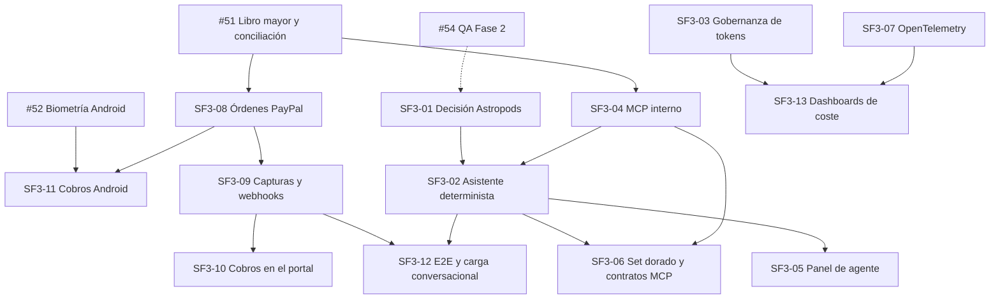

# Issues — Fase 3 (Sprints 5 y 6)

> Las issues se crean en GitHub a partir de este documento; **este archivo es la fuente de verdad del alcance**.
> Convención de ID: `SF3-NN`; el número de GitHub se conserva en la tabla de resumen cuando exista.
> Epic: **#84** · Issues: **#71–#83**

## Resumen

| ID     | Título                                                 | Labels                                     | Owner      | SP  | Sprint | GitHub |
| ------ | ------------------------------------------------------ | ------------------------------------------ | ---------- | --- | ------ | ------ |
| SF3-01 | Evaluación de Astropods y ADR de orquestación          | `agent`, `documentation`, `backend`        | Backend 2  | 3   | 5      | #71    |
| SF3-02 | Asistente conversacional determinista sin streaming    | `agent`, `backend`                         | Backend 2  | 8   | 5      | #72    |
| SF3-03 | Gobernanza de tokens: presupuesto, caché y degradación | `agent`, `backend`, `security`, `database` | Backend 1  | 8   | 5      | #73    |
| SF3-04 | Servidor MCP interno con herramientas auditadas        | `agent`, `backend`, `security`             | Backend 1  | 8   | 5      | #74    |
| SF3-05 | Panel de agente con chat, citas y presupuesto          | `web`, `frontend`, `agent`                 | Frontend 2 | 8   | 5      | #75    |
| SF3-06 | Set dorado de cifras y contract tests MCP              | `qa`, `agent`                              | Backend 1  | 4   | 5      | #76    |
| SF3-07 | OpenTelemetry de extremo a extremo                     | `devops`, `infrastructure`                 | Frontend 1 | 5   | 5      | #77    |
| SF3-08 | Órdenes y enlaces de cobro PayPal                      | `backend`, `security`, `paypal`            | Backend 1  | 8   | 6      | #78    |
| SF3-09 | Capturas, reembolsos y webhooks firmados               | `backend`, `security`, `paypal`            | Backend 1  | 8   | 6      | #79    |
| SF3-10 | Cobros PayPal en el portal con aprobación humana       | `web`, `frontend`, `paypal`, `security`    | Frontend 1 | 8   | 6      | #80    |
| SF3-11 | Cobros y aprobación biométrica en Android              | `mobile`, `security`, `paypal`             | Frontend 2 | 8   | 6      | #81    |
| SF3-12 | E2E de agentes, MCP y PayPal + carga conversacional    | `qa`, `backend`, `paypal`                  | Backend 2  | 8   | 6      | #82    |
| SF3-13 | Dashboards de coste de tokens y latencia               | `devops`, `observability`                  | Frontend 2 | 4   | 6      | #83    |

Todas las issues llevan además los labels `phase-3` y el correspondiente `sprint-5` o `sprint-6`.

---

## SF3-01 — [Agent][Decision] Evaluación de Astropods y ADR de orquestación

**Labels:** `phase-3`, `sprint-5`, `agent`, `documentation`, `backend`
**Owner:** Backend 2 · **SP:** 3 · **Depende de:** —

### Contexto

§2.6 del plan marco deja Astropods como opción, no como dependencia dura: la orquestación vive en `agent-service`. Antes de construir el asistente hay que decidir si Astropods aporta valor real sobre la orquestación propia, con evidencia y no con impresiones.

### Alcance

- Definir tres escenarios de comparación: consulta de saldo simple, consulta multi-herramienta y fallo del proveedor del modelo.
- Implementar un prototipo mínimo de cada escenario con orquestación propia en `agent-service` y, contra el mismo escenario, con Astropods en entorno de pruebas.
- Comparar latencia, coste por conversación, complejidad operativa, observabilidad y reversibilidad.
- Redactar `docs/adr/007-orquestacion-agentes.md` con decisión, contexto, alternativas y consecuencias.
- Fijar el criterio de reversibilidad: qué costaría sustituir la capa de orquestación y qué interfaz de herramientas debe permanecer estable.

### Fuera de alcance

- Integrar Astropods en producción o contratar licencia.
- Implementar el asistente completo (SF3-02).
- Definir el servidor MCP (SF3-04).

### Criterios de aceptación

- [ ] El ADR-007 existe, sigue la plantilla de `docs/adr/` y declara una decisión explícita.
- [ ] Los tres escenarios se ejecutan con orquestación propia y quedan documentados con resultados medidos.
- [ ] Si Astropods se evalúa, los resultados se comparan con los mismos escenarios y dataset.
- [ ] La comparación incluye latencia p95, coste estimado por conversación y esfuerzo de integración.
- [ ] El ADR define la interfaz de herramientas que sobrevive a cualquier cambio de orquestador.
- [ ] Existe criterio escrito de reversibilidad y de cuándo se revisaría la decisión.
- [ ] Ninguna dependencia nueva de Astropods se añade al `package.json` de producción.

### Validación

```bash
pnpm exec prettier --check docs/adr/007-orquestacion-agentes.md
pnpm --filter @mybusiness/agent-service test
```

---

## SF3-02 — [Agent] Asistente conversacional determinista sin streaming

**Labels:** `phase-3`, `sprint-5`, `agent`, `backend`
**Owner:** Backend 2 · **SP:** 8 · **Depende de:** SF3-01, SF3-04

### Contexto

El asistente debe conversar sobre finanzas sin calcular nada: recibe JSON determinista del backend, invoca herramientas MCP y redacta. Esta issue construye el camino completo de una pregunta a una respuesta con citas, sin streaming.

### Alcance

- Patrón RPC `agent.chat` en `packages/contracts/src/patterns` y su DTO de entrada/salida.
- Recuperación de contexto de memoria (`agent.memory.search`) y pasaje de herramientas MCP al modelo.
- Respuesta con citas explícitas a las herramientas y a los datos usados (`citations[]`).
- Prohibición de aritmética en el LLM: los importes sólo pueden provenir de la salida de una herramienta.
- Timeouts por conversación y por herramienta, con degradación a respuesta sin LLM.
- Manejo de errores del proveedor con códigos estables y sin filtrar la clave.
- Tests con proveedor falso determinista y snapshots de citas.

### Fuera de alcance

- Streaming SSE o incremental (Fase 4).
- Panel web (SF3-05).
- Presupuesto y caché (SF3-03); esta issue consume la cabecera de consumo.

### Criterios de aceptación

- [ ] `agent.chat` responde a una pregunta de flujo de caja citando `get_cashflow_summary` y el periodo.
- [ ] Ninguna cifra de la respuesta existe si no proviene de una herramienta; el test lo demuestra con un proveedor falso que devuelve basura.
- [ ] `tenantId` y `userId` provienen sólo del contexto firmado; el DTO no los acepta.
- [ ] Un timeout del proveedor devuelve respuesta degradada con código estable y sin error 500.
- [ ] Una segunda pregunta del mismo usuario reutiliza el contexto de memoria del tenant correcto.
- [ ] El proveedor falso permite ejecutar toda la suite sin red ni claves.
- [ ] Cobertura ≥ 80 % en los archivos nuevos de `agent-service`.

### Validación

```bash
pnpm --filter @mybusiness/agent-service test
pnpm --filter @mybusiness/agent-service test:cov
pnpm --filter @mybusiness/api-gateway test
```

---

## SF3-03 — [Agent] Gobernanza de tokens: presupuesto, caché y degradación

**Labels:** `phase-3`, `sprint-5`, `agent`, `backend`, `security`, `database`
**Owner:** Backend 1 · **SP:** 8 · **Depende de:** —

### Contexto

Sin límite duro, un tenant puede consumir el presupuesto de toda la plataforma. El control debe vivir en el servidor y ser verificable: ni el portal ni Android pueden eludirlo. `agent_db` ya existe y es el lugar natural para el contador.

### Alcance

- Migración de `agent_db`: tablas de presupuesto por tenant (límite mensual en tokens y en coste), consumo acumulado y registro de caché.
- Contador atómico por tenant y periodo, resistente a concurrencia.
- Caché semántica de respuestas con umbral de similitud configurable y expiración.
- Cabecera de consumo (`tokensUsed`, `budget`, `remaining`) en la respuesta de `agent.chat`.
- Degradación a respuesta sin LLM al agotar el presupuesto y evento de auditoría `agent.budget.exhausted`.
- Tests de concurrencia y de aislamiento entre tenants.

### Fuera de alcance

- Facturación del consumo al cliente.
- Panel de dashboards (SF3-13), que sólo lee las métricas expuestas aquí.
- Caché distribuida fuera de `agent_db`.

### Criterios de aceptación

- [ ] Superar el límite mensual impide llamar al proveedor y devuelve respuesta degradada marcada.
- [ ] Dos peticiones concurrentes del mismo tenant no pueden exceder el límite por condición de carrera.
- [ ] El consumo de un tenant nunca aparece en la respuesta ni en las métricas de otro.
- [ ] Una pregunta equivalente dentro del umbral se sirve desde caché sin consumir tokens.
- [ ] Agotar el presupuesto emite `agent.budget.exhausted` con tenant, periodo y consumo.
- [ ] La migración se aplica y revierte de forma limpia en una base vacía.
- [ ] Existen tests de concurrencia con al menos 20 peticiones simultáneas.

### Validación

```bash
pnpm --filter @mybusiness/agent-service test
pnpm --filter @mybusiness/agent-service test:e2e
pnpm --filter @mybusiness/agent-service db:migrate
```

---

## SF3-04 — [Agent] Servidor MCP interno con herramientas auditadas

**Labels:** `phase-3`, `sprint-5`, `agent`, `backend`, `security`
**Owner:** Backend 1 · **SP:** 8 · **Depende de:** #51

### Contexto

El modelo no puede tocar la base de datos ni el gateway directamente. El servidor MCP interno es la única vía: expone herramientas acotadas, valida esquemas y deja rastro de cada invocación. Se apoya en el libro mayor y la conciliación de #51. Las herramientas de este sprint son de solo lectura; cualquier herramienta de escritura llegará con PayPal y el flujo de aprobación humana (HITL).

### Alcance

- Endpoint MCP (JSON-RPC sobre stdio o HTTP, según ADR-008) con dos herramientas: `get_cashflow_summary`, `list_unreconciled_transactions`.
- `create_payment_link` se implementa en SF3-08, cuando exista la orden PayPal; hasta entonces el servidor no anuncia esa capacidad.
- Validación de esquema de entrada y salida con Zod de `packages/contracts`; rechazo de campos desconocidos.
- `tenantId` y `userId` inyectados desde el contexto firmado, nunca desde el payload del modelo.
- Auditoría por invocación con `mcp.tool.invoked` (herramienta, argumentos minimizados, resultado, latencia).
- Rate limit por tenant y errores tipados (`TOOL_INVALID_INPUT`, `TOOL_FORBIDDEN`, `TOOL_TIMEOUT`).
- Versión del esquema de herramientas declarada y verificable.
- Tests de contrato de entrada y salida de cada herramienta.

### Fuera de alcance

- Herramientas de escritura en general: este sprint solo expone lectura.
- Herramienta `create_payment_link` (SF3-08).
- Exposición del servidor MCP fuera de la red interna.
- Orquestación del modelo (SF3-02).

### Criterios de aceptación

- [ ] Las dos herramientas responden con datos reales del tenant y esquema validado.
- [ ] Una entrada con campos extra o tipos incorrectos devuelve `TOOL_INVALID_INPUT` sin ejecutar la consulta.
- [ ] Cada invocación, exitosa o fallida, genera exactamente un evento `mcp.tool.invoked`.
- [ ] Un tenant no puede invocar herramientas sobre datos de otro, ni forzando argumentos.
- [ ] La versión del esquema aparece en la respuesta de capacidades del servidor.
- [ ] Los tests de contrato cubren entrada válida, entrada inválida y salida.

### Validación

```bash
pnpm --filter @mybusiness/agent-service test
pnpm --filter @mybusiness/agent-service test:e2e
pnpm --filter @mybusiness/api-gateway test
```

---

## SF3-05 — [Web] Panel de agente con chat, citas y presupuesto

**Labels:** `phase-3`, `sprint-5`, `web`, `frontend`, `agent`
**Owner:** Frontend 2 · **SP:** 8 · **Depende de:** SF3-02

### Contexto

Primera pantalla conversacional del portal. Debe dejar claro de dónde sale cada cifra y cuánto presupuesto queda, sin dar la impresión de que el modelo calcula. La sesión la gestiona el BFF; el navegador nunca habla con el gateway ni con el proveedor.

### Alcance

- Ruta `/agente` dentro del route group `(app)`, con carga de sesión en el servidor.
- Historial de conversación paginado y virtualizado.
- Mensajes con citas a herramientas y datos (herramienta, periodo, enlace al libro mayor cuando aplique).
- Indicador de presupuesto restante y aviso al superar el 80 %.
- Estados de carga, vacío, error de proveedor y respuesta degradada sin LLM.
- Envío con CSRF a través del BFF; sin llamadas directas al gateway.
- `prefers-reduced-motion`, navegación por teclado y axe sin violaciones críticas.

### Fuera de alcance

- Streaming de la respuesta (Fase 4).
- Renderizado de gráficos generados por el agente (Fase 4).
- Edición o borrado de memoria desde la interfaz.

### Criterios de aceptación

- [ ] Se envía una pregunta y se recibe respuesta con al menos una cita visible y navegable.
- [ ] La cifra mostrada coincide con la del backend para el mismo periodo del tenant de demo.
- [ ] Un POST sin token CSRF válido es rechazado y la UI muestra error accionable.
- [ ] El estado de presupuesto se actualiza tras cada mensaje y avisa al 80 %.
- [ ] Una respuesta degradada se distingue visualmente de una respuesta normal.
- [ ] El historial de 200 mensajes se desplaza sin bloquear la interfaz.
- [ ] axe sin violaciones críticas y foco visible en todo el flujo.

### Validación

```bash
pnpm --filter @mybusiness/web lint
pnpm --filter @mybusiness/web typecheck
pnpm --filter @mybusiness/web test:unit
pnpm --filter @mybusiness/web test
```

---

## SF3-06 — [QA] Set dorado de cifras y contract tests MCP

**Labels:** `phase-3`, `sprint-5`, `qa`, `agent`
**Owner:** Backend 1 · **SP:** 4 · **Depende de:** SF3-02, SF3-04

### Contexto

La promesa de la fase es que las cifras del chat sean verificables. Eso exige un conjunto congelado de preguntas con su cifra esperada obtenida por SQL, y un umbral de coincidencia que rompa el pipeline.

### Alcance

- 30 preguntas doradas sobre el dataset de demo, cada una con su consulta SQL de referencia y la cifra esperada.
- Ejecución en CI contra `agent-service` con proveedor falso determinista.
- Comparación numérica exacta en unidad mínima, tolerancia cero.
- Contract tests de esquemas MCP de entrada y salida para las tres herramientas.
- Reporte legible con preguntas fallidas, cifra esperada y cifra obtenida.
- Umbral bloqueante: 100 % de coincidencia numérica.

### Fuera de alcance

- Evaluación de calidad estilística de las respuestas.
- Benchmark de proveedores de modelo.
- Pruebas de carga (SF3-12).

### Criterios de aceptación

- [ ] Las 30 preguntas tienen SQL de referencia versionado junto al fixture.
- [ ] La suite se ejecuta en CI y falla si una sola cifra difiere.
- [ ] Los contract tests cubren las tres herramientas en entrada y salida.
- [ ] El reporte identifica la pregunta, la cifra esperada y la obtenida en cada fallo.
- [ ] El set dorado usa datos del tenant de demo y no depende de red ni de claves reales.
- [ ] Añadir una pregunta nueva no requiere tocar el runner.

### Validación

```bash
pnpm --filter @mybusiness/agent-service test
pnpm test:e2e
```

---

## SF3-07 — [Observability] OpenTelemetry de extremo a extremo

**Labels:** `phase-3`, `sprint-5`, `devops`, `infrastructure`
**Owner:** Frontend 1 · **SP:** 5 · **Depende de:** —

### Contexto

Hoy la correlación depende de logs por servicio. Sin trazas no se puede demostrar dónde se va la latencia del chat ni atribuir el coste a un tenant y un canal.

### Alcance

- SDK de OpenTelemetry en `api-gateway`, `auth-service`, `finance-service`, `agent-service`, `audit-service` y `apps/web`.
- Propagación W3C `traceparent`/`tracestate` entre BFF, gateway y RPC por Redis.
- Atributos `tenantId`, `traceId`, `channel`, `userRole`; sin PII ni contenido de mensajes.
- Exportador OTLP configurable por entorno.
- `docker/docker-compose.yml` con collector y Jaeger/Tempo para desarrollo.
- Sampling configurable (ratio por entorno) y documentación en `docs/observability.md`.

### Fuera de alcance

- Alertas y dashboards (SF3-13).
- Instrumentación de la app Android.
- Backend de trazas gestionado en producción (Fase 6).

### Criterios de aceptación

- [ ] Una petición web genera una traza única que atraviesa BFF, gateway y servicio de dominio.
- [ ] El contexto se propaga también en llamadas RPC por Redis.
- [ ] Toda traza incluye `tenantId`, `channel` y `userRole`, y ninguna incluye PII ni texto de mensajes.
- [ ] `docker compose up` levanta collector y Jaeger/Tempo y las trazas son consultables.
- [ ] El sampling se cambia por variable de entorno sin recompilar.
- [ ] La instrumentación no rompe tests existentes ni añade latencia perceptible (p95 < 50 ms de overhead).
- [ ] `docs/observability.md` describe variables, atributos y cómo consultar una traza.

### Validación

```bash
docker compose --env-file .env -f docker/docker-compose.yml up -d
pnpm --filter @mybusiness/api-gateway test
pnpm --filter @mybusiness/agent-service test
pnpm exec prettier --check docs/observability.md
```

---

## SF3-08 — [PayPal] Órdenes y enlaces de cobro

**Labels:** `phase-3`, `sprint-6`, `backend`, `security`, `paypal`
**Owner:** Backend 1 · **SP:** 8 · **Depende de:** #51, SF3-04

### Contexto

El cobro empieza por una orden de PayPal asociada a una factura del libro mayor. La orden debe ser idempotente y auditable, y el importe debe viajar en unidad mínima según ADR-003.

### Alcance

- `POST /payments/paypal/orders` con importe en unidad menor, moneda, descripción y referencia a factura.
- Cliente PayPal con configuración separada de sandbox y producción; credenciales sólo por entorno.
- Idempotencia por clave de idempotencia del cliente, con persistencia de la respuesta original.
- Persistencia de la orden y sus estados (`CREATED`, `APPROVED`, `CAPTURED`, `FAILED`, `REFUNDED`).
- Devolución del enlace de checkout de PayPal.
- Herramienta MCP `create_payment_link` (misma validación estricta, contexto firmado, auditoría `mcp.tool.invoked` y rate limit que SF3-04), que crea una orden PayPal y devuelve el link de checkout.
- RBAC: sólo roles con permiso de cobro crean órdenes; aislamiento por tenant.
- Tests con cliente PayPal stubbeado y casos de error del proveedor.

### Fuera de alcance

- Captura y reembolso (SF3-09).
- Interfaz de usuario (SF3-10, SF3-11).
- Conciliación automática de la orden con la factura (SF3-09).

### Criterios de aceptación

- [ ] Una orden creada devuelve enlace de checkout y queda persistida con estado `CREATED`.
- [ ] Repetir la petición con la misma clave de idempotencia devuelve la misma orden sin crear otra.
- [ ] Un importe con decimales o negativo se rechaza antes de llamar a PayPal.
- [ ] Un usuario sin rol de cobro recibe 403 y no se crea ninguna orden.
- [ ] La orden de un tenant no es visible ni utilizable desde otro.
- [ ] Un error de PayPal devuelve código estable sin filtrar credenciales.
- [ ] Cada creación genera auditoría con factura, importe y actor.
- [ ] La herramienta MCP `create_payment_link` crea una orden idempotente y exige contexto autorizado; queda cubierta por contract tests y auditoría.

### Validación

```bash
pnpm --filter @mybusiness/finance-service test
pnpm --filter @mybusiness/api-gateway test:e2e
```

---

## SF3-09 — [PayPal] Capturas, reembolsos y webhooks firmados

**Labels:** `phase-3`, `sprint-6`, `backend`, `security`, `paypal`
**Owner:** Backend 1 · **SP:** 8 · **Depende de:** SF3-08

### Contexto

El dinero se mueve en la captura y vuelve en el reembolso. Ambos deben ser idempotentes, auditados y conciliados con la factura, y el webhook que los notifica debe verificarse por firma y resistir duplicados.

### Alcance

- Captura total y parcial de una orden aprobada, con persistencia del identificador de captura.
- Reembolso total y parcial con motivo obligatorio y auditoría.
- `POST /payments/paypal/webhooks` con body crudo y verificación de firma de PayPal; fail-closed sin secreto.
- Dedupe por `event_id`; duplicado responde 200 sin reprocesar.
- Máquina de estados `CREATED → APPROVED → CAPTURED → REFUNDED` con transiciones inválidas rechazadas.
- Reintentos con backoff para fallos transitorios del proveedor.
- Conciliación de la orden con la factura y evento `payments.paypal.captured` / `payments.paypal.refunded`.

### Fuera de alcance

- Suscripciones y pagos recurrentes.
- Disputas y contracargos.
- Reembolsos sin aprobación humana en la interfaz (SF3-10, SF3-11).

### Criterios de aceptación

- [ ] Una orden aprobada en sandbox se captura y la factura queda conciliada.
- [ ] Un reembolso parcial ajusta el importe y deja motivo y actor en auditoría.
- [ ] Un webhook con firma inválida devuelve 401 y no modifica ninguna orden.
- [ ] Un evento duplicado responde 200 y no reprocesa ni duplica la captura.
- [ ] Una transición inválida (reembolsar una orden no capturada) devuelve error tipado.
- [ ] Un fallo transitorio del proveedor reintenta y termina en estado visible.
- [ ] Tests de firma, dedupe, transiciones y reintentos.

### Validación

```bash
pnpm --filter @mybusiness/finance-service test
pnpm --filter @mybusiness/finance-service test:e2e
pnpm --filter @mybusiness/api-gateway test:e2e
```

---

## SF3-10 — [Web] Cobros PayPal en el portal con aprobación humana

**Labels:** `phase-3`, `sprint-6`, `web`, `frontend`, `paypal`, `security`
**Owner:** Frontend 1 · **SP:** 8 · **Depende de:** SF3-09

### Contexto

El portal es donde un administrador crea el enlace y aprueba la captura o el reembolso. La interfaz no calcula importes: los recibe del backend en unidad mínima y los formatea. Toda acción con dinero exige confirmación explícita y reautenticación.

### Alcance

- Crear enlace de cobro desde una factura del libro mayor.
- Listado de órdenes con estado, importe, moneda y fecha, con paginación server-side.
- Captura y reembolso con confirmación explícita y reautenticación previa.
- Manejo de errores del proveedor con mensaje accionable y reintento.
- Exportación CSV del listado y estado vacío diferenciado de error.
- RBAC en UI y en BFF; CSRF en todas las mutaciones.
- axe AA, foco visible y `prefers-reduced-motion`.

### Fuera de alcance

- Aprobación biométrica (SF3-11, Android).
- Conciliación manual de órdenes.
- Flujo de disputas.

### Criterios de aceptación

- [ ] Se crea un enlace desde una factura y el listado muestra la orden en `CREATED`.
- [ ] Capturar exige confirmación explícita y reautenticación; sin ellas no se envía la petición.
- [ ] Un reembolso exige motivo y muestra el importe resultante antes de confirmar.
- [ ] Un usuario sin rol de cobro no ve las acciones ni puede invocarlas por API.
- [ ] Un error de PayPal muestra mensaje accionable y permite reintentar.
- [ ] La exportación CSV respeta filtros y aislamiento por tenant.
- [ ] axe sin violaciones críticas y flujo completo operable por teclado.

### Validación

```bash
pnpm --filter @mybusiness/web lint
pnpm --filter @mybusiness/web typecheck
pnpm --filter @mybusiness/web test:unit
pnpm --filter @mybusiness/web test
```

---

## SF3-11 — [Mobile] Cobros y aprobación biométrica en Android

**Labels:** `phase-3`, `sprint-6`, `mobile`, `security`, `paypal`
**Owner:** Frontend 2 · **SP:** 8 · **Depende de:** SF3-08, #52

### Contexto

La app ya cuenta con `SensitiveAction` y el módulo `core/biometric` de #52. Capturar o reembolsar desde el móvil debe reutilizar esa protección en lugar de crear un flujo paralelo.

### Alcance

- Pantalla de órdenes con estado, importe y factura asociada.
- Captura y reembolso protegidos por `BiometricPrompt` mediante `SensitiveAction`.
- Deep link de retorno de PayPal y refresco de estado al volver a la app.
- Estados de carga, vacío, error y orden ya capturada.
- Tokens en almacenamiento cifrado; prohibido registrar tokens o datos de pago en logs.
- Tests de ViewModel con repositorio falso.

### Fuera de alcance

- Creación de órdenes en la app (se hace en web).
- Passkeys o biometría en web (Fase 4).
- Notificaciones push de cobro (Fase 4).

### Criterios de aceptación

- [ ] La pantalla lista las órdenes del tenant con su estado real.
- [ ] Sin biometría válida no se ejecuta ni la captura ni el reembolso.
- [ ] El fallback a credencial de dispositivo funciona en el emulador configurado.
- [ ] El deep link de retorno actualiza el estado de la orden sin recargar manualmente.
- [ ] Una orden ya capturada se muestra como tal y no permite recapturar.
- [ ] Los logs no contienen tokens, identificadores de pago ni datos personales.
- [ ] Tests de ViewModel en verde para éxito, rechazo biométrico y error de red.

### Validación

```bash
cd apps/mobile-android && ./gradlew :core:biometric:testDebugUnitTest
cd apps/mobile-android && ./gradlew :app:testDebugUnitTest
cd apps/mobile-android && ./gradlew :app:assembleDebug
```

---

## SF3-12 — [QA] E2E de agentes, MCP y PayPal + carga conversacional

**Labels:** `phase-3`, `sprint-6`, `qa`, `backend`, `paypal`
**Owner:** Backend 2 · **SP:** 8 · **Depende de:** SF3-02, SF3-09

### Contexto

La fase introduce dos caminos nuevos y críticos: el conversacional y el de dinero. Ambos deben probarse de extremo a extremo en los dos canales y bajo concurrencia, no sólo con tests unitarios.

### Alcance

- E2E Playwright: login → `/agente` → pregunta → cita → presupuesto actualizado.
- E2E PayPal: factura → enlace → pago sandbox → webhook firmado → conciliación → reembolso aprobado.
- E2E Android de captura con biometría (emulador con credencial configurada).
- Contract tests del servidor MCP ejecutados en CI contra el esquema versionado.
- Prueba de carga con 50 conversaciones concurrentes: p95 < 3 s sin LLM y < 8 s con LLM en sandbox.
- Escenarios negativos: presupuesto agotado, webhook duplicado, reembolso rechazado.
- Reporte de resultados adjunto al PR.

### Fuera de alcance

- Pruebas de penetración (Fase 5).
- Carga de ingesta bancaria (cubierta en Fase 2).
- Medición de calidad conversacional.

### Criterios de aceptación

- [ ] Los E2E de chat y de PayPal pasan en verde en CI con servicios levantados por Docker.
- [ ] El E2E de Android valida que sin biometría no hay captura.
- [ ] Los contract tests MCP fallan si el esquema cambia sin actualizar el cliente.
- [ ] La prueba de carga sostiene 50 conversaciones concurrentes con p95 < 3 s sin LLM y < 8 s con LLM.
- [ ] Con presupuesto agotado, el sistema responde degradado y no llama al proveedor.
- [ ] Un webhook duplicado no altera el estado ni duplica la conciliación.
- [ ] El reporte de resultados queda adjunto con métricas y fallos.

### Validación

```bash
pnpm test:e2e
pnpm --filter @mybusiness/api-gateway test:e2e
k6 run tests/load/chat-50-concurrent.js
```

---

## SF3-13 — [Observability] Dashboards de coste de tokens y latencia

**Labels:** `phase-3`, `sprint-6`, `devops`, `observability`
**Owner:** Frontend 2 · **SP:** 4 · **Depende de:** SF3-03, SF3-07

### Contexto

Las métricas de gobernanza y las trazas existen, pero nadie las mira. Este issue las convierte en paneles operables con una alerta que avisa antes de que un tenant agote su presupuesto.

### Alcance

- Paneles de tokens y coste por tenant y por modelo.
- Tasa de acierto de caché semántica y ahorro estimado.
- p50/p95 de latencia del chat, separando respuestas con y sin LLM.
- Errores MCP por herramienta y por código de error.
- Alerta cuando el gasto de un tenant supera el 80 % de su presupuesto mensual.
- Documentación de cómo interpretar cada panel en `docs/observability.md`.

### Fuera de alcance

- Alertas de infraestructura (CPU, memoria) ajenas al producto.
- Facturación del consumo.
- Paneles de negocio (MRR, churn).

### Criterios de aceptación

- [ ] Existe un panel con tokens y coste desglosado por tenant y modelo.
- [ ] La tasa de caché se muestra con la serie temporal y su ahorro estimado.
- [ ] La latencia del chat se ve en p50 y p95, separando con y sin LLM.
- [ ] Los errores MCP se agrupan por herramienta y código, no por mensaje libre.
- [ ] La alerta se dispara al 80 % del presupuesto y no repite aviso cada minuto.
- [ ] `docs/observability.md` explica cada panel y su consulta asociada.

### Validación

```bash
docker compose --env-file .env -f docker/docker-compose.yml up -d
pnpm exec prettier --check docs/observability.md
pnpm --filter @mybusiness/web lint
```

---

## Dependencias


