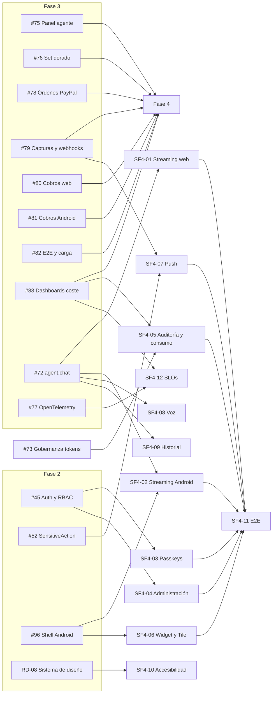

# Issues — Fase 4 (Sprints 7 y 8)

> Las issues se crearán en GitHub a partir de este documento; **este archivo es la fuente de verdad del alcance**.
> Convención de ID: `SF4-NN`; la columna `GitHub` se rellena cuando exista el número.
> Ventana: **Sprint 7** 2026-12-28 → 2027-01-08 · **Sprint 8** 2027-01-11 → 2027-01-22 · **Capacidad:** 84 SP.
> Epic: **#126** · Issues: **#114–#125**

## Resumen

| ID     | Título                                                         | Labels                       | Owner    | SP  | Sprint | GitHub |
| ------ | -------------------------------------------------------------- | ---------------------------- | -------- | --- | ------ | ------ |
| SF4-01 | [Web] Streaming del asistente con SSE                          | `web`, `frontend`, `agent`   | Umbrex47 | 8   | 7      | #114   |
| SF4-02 | [Mobile] Streaming del asistente en Android                    | `mobile`, `agent`            | JuanchR4 | 8   | 7      | #115   |
| SF4-03 | [Web] Passkeys/WebAuthn                                        | `web`, `security`            | Umbrex47 | 8   | 7      | #116   |
| SF4-06 | [Mobile] Glance widget y Quick Settings Tile                   | `mobile`, `design`           | JuanchR4 | 8   | 7      | #119   |
| SF4-09 | [Agent] Historial de conversaciones y feedback                 | `agent`, `backend`           | Umbrex47 | 5   | 7      | #122   |
| SF4-10 | [Web] Accesibilidad avanzada y modo denso                      | `web`, `accessibility`, `ux` | Umbrex47 | 5   | 7      | #123   |
| SF4-04 | [Web] Administración de tenant: usuarios, roles e invitaciones | `web`, `security`, `backend` | Umbrex47 | 8   | 8      | #117   |
| SF4-05 | [Web] Visor de auditoría y consumo por tenant                  | `devops`, `web`              | Umbrex47 | 5   | 8      | #118   |
| SF4-07 | [Mobile] Notificaciones push con FCM                           | `mobile`, `security`         | JuanchR4 | 8   | 8      | #120   |
| SF4-08 | [Mobile] `VoiceInteractionService`                             | `mobile`, `agent`            | JuanchR4 | 8   | 8      | #121   |
| SF4-11 | [QA] E2E de streaming, passkeys, admin y push                  | `qa`, `web`, `mobile`        | JuanchR4 | 8   | 8      | #124   |
| SF4-12 | [Observability] SLOs y alertas de streaming/chat               | `devops`, `observability`    | Umbrex47 | 5   | 8      | #125   |

Todas las issues llevan además los labels `phase-4` y el correspondiente `sprint-7` o `sprint-8`.

---

## Fichas

## SF4-01 — [Web] Streaming del asistente con SSE

**Labels:** `phase-4`, `sprint-7`, `web`, `frontend`, `agent`
**Owner:** Umbrex47 · **SP:** 8 · **Depende de:** #72

### Contexto

En Fase 3 el asistente responde de golpe. La percepción de espera es el principal motivo de abandono del chat, y el contrato `agent.chat` ya está versionado para admitir un canal incremental. El navegador no puede hablar con el gateway: el streaming debe atravesar el BFF sin exponer cookies ni claves.

### Alcance

- Patrón `agent.chat.stream` en `packages/contracts`, con eventos tipados (`token`, `tool`, `citation`, `done`, `error`) y `id` de evento.
- Endpoint en el BFF que consume el stream del gateway y lo reexpone como `ReadableStream` (SSE) al navegador.
- Consumo en `/agente` con lectura incremental, render progresivo y `aria-busy` durante la generación.
- Cancelación con `AbortController`: al cancelar se cierra la conexión y se notifica al backend.
- Reconexión con `Last-Event-ID` y reanudación sin duplicar tokens ni mensajes.
- Citas por herramienta mostradas al completarse cada invocación, no al final.
- Estados: conectando, generando, herramienta en uso, cancelado, error y fallback a respuesta no streaming.
- Sin volcado de tokens ni de contenido en logs.

### Fuera de alcance

- Streaming en Android (SF4-02).
- Cambios en la orquestación o en el set dorado (Fase 3).
- Historial persistente de conversaciones (SF4-09).

### Criterios de aceptación

- [ ] El primer token llega con p95 < 2 s en entorno local con el proveedor falso.
- [ ] Cancelar detiene el consumo en la UI, cierra la conexión y no deja stream abierto en el servidor.
- [ ] Una reconexión con `Last-Event-ID` no duplica mensajes ni tokens ya renderizados.
- [ ] Cada cita aparece vinculada a su herramienta y periodo cuando el evento `citation` llega.
- [ ] Si el canal incremental falla, la UI cae a respuesta no streaming con aviso visible.
- [ ] axe sin violaciones críticas y el flujo completo es operable por teclado.
- [ ] Ningún log de BFF o web contiene tokens, prompts ni contenido del mensaje.

### Validación

```bash
pnpm --filter @mybusiness/web lint
pnpm --filter @mybusiness/web typecheck
pnpm --filter @mybusiness/web test:unit
pnpm --filter @mybusiness/web test
pnpm exec prettier --check apps/web
```

---

## SF4-02 — [Mobile] Streaming del asistente en Android

**Labels:** `phase-4`, `sprint-7`, `mobile`, `agent`
**Owner:** JuanchR4 · **SP:** 8 · **Depende de:** #72, #96

### Contexto

La app Android ya consume `agent.chat` de forma bloqueante. Un usuario móvil tolera aún menos la espera que uno web, y el ciclo de vida de Android (rotación, background) rompe cualquier implementación ingenua de streaming. Se apoya en el shell y la navegación de #96.

### Alcance

- Cliente SSE sobre OkHttp con exposición como `Flow<ChatStreamEvent>` y cancelación estructurada.
- Repositorio de chat que combina streaming con el historial local de la conversación.
- Cancelación automática al salir de la pantalla y al pasar a background según política definida.
- Supervivencia a la rotación: el mensaje en curso se conserva en el `ViewModel`.
- Indicador de herramienta en uso durante la generación.
- Degradación a respuesta no streaming cuando el canal incremental no está disponible.
- Tests de `ViewModel` con proveedor de streaming falso, sin red.

### Fuera de alcance

- Streaming web (SF4-01).
- Consulta por voz (SF4-08), que reutiliza el repositorio pero no el canal incremental.
- Notificaciones push (SF4-07).

### Criterios de aceptación

- [ ] La respuesta se renderiza de forma incremental y el `Flow` se cancela al destruir la pantalla.
- [ ] Rotar el dispositivo durante la respuesta no pierde el mensaje en curso ni duplica tokens.
- [ ] Cancelar cierra explícitamente la conexión HTTP y no deja corrutinas vivas.
- [ ] El indicador de herramienta aparece mientras el evento `tool` está activo y desaparece al terminar.
- [ ] Sin canal incremental, la app responde con el endpoint clásico y muestra aviso no intrusivo.
- [ ] Los tests de `ViewModel` corren con proveedor falso, sin red ni claves.
- [ ] TalkBack anuncia el mensaje completo al finalizar, no cada token.

### Validación

```bash
./gradlew :app:testDebugUnitTest
./gradlew :app:lintDebug
./gradlew :app:assembleDebug
```

---

## SF4-03 — [Web] Passkeys/WebAuthn

**Labels:** `phase-4`, `sprint-7`, `web`, `security`
**Owner:** Umbrex47 · **SP:** 8 · **Depende de:** #45

### Contexto

El acceso depende hoy de contraseña. Passkeys elimina el vector de phishing y credential stuffing, pero exige un origen seguro estable, un `RP ID` definitivo y un challenge emitido y consumido en el servidor. La autenticación y el RBAC ya existen desde #45.

### Alcance

- Registro de passkey con clave residente desde la pantalla de seguridad del usuario.
- Login con passkey y passkey como segundo factor tras contraseña.
- Gestión de credenciales: listado con nombre y fecha, renombrado y revocación.
- Fallback a contraseña cuando el dispositivo no soporta WebAuthn.
- Challenge generado en servidor, de un solo uso, con TTL corto y ligado a la sesión.
- Validación estricta de `RP ID` y `origin` contra lista permitida por entorno.
- Persistencia de credenciales (id, clave pública, contador, transporte) ligada al usuario.
- Auditoría de registro, login y revocación sin datos biométricos.

### Fuera de alcance

- Passkeys en Android (fuera de esta fase; la app mantiene biometría de #52).
- Recuperación de cuenta por correo más allá del fallback a contraseña.
- Eliminación de la contraseña como factor obligatorio.

### Criterios de aceptación

- [ ] Registro y login con passkey funcionan en Chrome y Firefox actuales.
- [ ] Un challenge reutilizado o caducado se rechaza con error tipado y sin filtrar detalles internos.
- [ ] Un `origin` o `RP ID` distinto del configurado se rechaza siempre.
- [ ] El usuario puede revocar una credencial y deja de servir para autenticarse de inmediato.
- [ ] Passkey como segundo factor no permite saltarse la contraseña cuando la política lo exige.
- [ ] Registro, login y revocación quedan en auditoría con actor, credencial y resultado.
- [ ] Tests unitarios de verificación y E2E con authenticator virtual en CI.

### Validación

```bash
pnpm --filter @mybusiness/web test:unit
pnpm --filter @mybusiness/web test:e2e
pnpm --filter @mybusiness/auth-service test
```

---

## SF4-06 — [Mobile] Glance widget y Quick Settings Tile

**Labels:** `phase-4`, `sprint-7`, `mobile`, `design`
**Owner:** JuanchR4 · **SP:** 8 · **Depende de:** #96

### Contexto

El valor del producto es diario; obligar a abrir la app para ver el saldo añade fricción innecesaria. Android ofrece Glance para widgets y `TileService` para Quick Settings. Ambos deben mostrar datos reales sin convertirse en un consumidor de red y batería descontrolado.

### Alcance

- Widget Glance con saldo actual y flujo del día, con estados vacío, cargando y error.
- Actualización por `WorkManager` con intervalo configurable y cache local; sin sondeo agresivo.
- Quick Settings Tile que abre la pantalla de resumen del día.
- Deep link interno desde widget y Tile a la ruta correcta de la app.
- Respeto de modo claro/oscuro y de tokens del sistema de diseño de `core/designsystem`.
- Pruebas en emulador API 34 para widget y Tile.

### Fuera de alcance

- Widgets configurables por el usuario o múltiples tamaños en esta fase.
- Datos de otras secciones distintas de saldo y flujo del día.
- Notificaciones push (SF4-07).

### Criterios de aceptación

- [ ] El widget renderiza con datos en cache en menos de 1 s desde que el launcher lo muestra.
- [ ] Sin cache, muestra estado vacío o de carga y no bloquea el launcher.
- [ ] La actualización en background no consulta la red más de lo configurado, verificable en logs.
- [ ] El Tile abre la pantalla de resumen correcta y refleja el estado activo/inactivo.
- [ ] Widget y Tile respetan modo oscuro y contraste AA.
- [ ] Funcionan en emulador API 34 sin crash ni ANR.

### Validación

```bash
./gradlew :app:testDebugUnitTest
./gradlew :app:lintDebug
./gradlew :app:connectedDebugAndroidTest
```

---

## SF4-09 — [Agent] Historial de conversaciones y feedback

**Labels:** `phase-4`, `sprint-7`, `agent`, `backend`
**Owner:** Umbrex47 · **SP:** 5 · **Depende de:** #72

### Contexto

Hoy cada conversación es efímera y no hay forma de saber si una respuesta fue útil. Sin historial no hay continuidad; sin feedback no hay señal para mejorar el set dorado. Ambos deben respetar el aislamiento por tenant y la minimización de datos.

### Alcance

- Persistencia de conversaciones y mensajes por tenant y usuario en `agent_db`.
- Endpoint de historial paginado por cursor, con orden estable y sin contenido en logs.
- Feedback por mensaje: útil / no útil y corrección opcional en texto libre.
- Registro de feedback en auditoría con referencia al mensaje, sin volcar contenido.
- Exportación del feedback al set dorado de evaluación como insumo, con anonimización.
- Borrado de conversación a petición del usuario y expiración configurable.

### Fuera de alcance

- Panel web de historial (lo consume SF4-01 en su estado mínimo).
- Entrenamiento de modelos o ajuste fino con el feedback.
- Analítica de producto sobre el historial.

### Criterios de aceptación

- [ ] Un usuario sólo accede a conversaciones de su tenant y su propio ámbito.
- [ ] El historial pagina con cursor y no devuelve duplicados al avanzar.
- [ ] El feedback queda auditado y es consultable por el set dorado sin exponer PII.
- [ ] El borrado a petición elimina mensajes y feedback asociado de forma verificable.
- [ ] Ningún log de `agent-service` contiene texto de mensajes ni correcciones.
- [ ] La migración se aplica y revierte limpiamente en base vacía.

### Validación

```bash
pnpm --filter @mybusiness/agent-service test
pnpm --filter @mybusiness/agent-service test:e2e
pnpm --filter @mybusiness/agent-service db:migrate
```

---

## SF4-10 — [Web] Accesibilidad avanzada y modo denso

**Labels:** `phase-4`, `sprint-7`, `web`, `accessibility`, `ux`
**Owner:** Umbrex47 · **SP:** 5 · **Depende de:** RD-08

### Contexto

El chat en streaming introduce cambios asíncronos que rompen la navegación por teclado y el anuncio a lectores de pantalla si no se diseña con cuidado. Además, los usuarios con muchas transacciones necesitan densidad sin perder legibilidad. El sistema de diseño de RD-08 es la base.

### Alcance

- Recorrido completo por teclado en chat, tablas y panel de administración, con foco visible y orden lógico.
- `aria-live="polite"` en la respuesta en streaming y anuncio de finalización sin leer token a token.
- Contraste AAA donde el token lo permita y revisión de pares de color del sistema.
- Soporte de `prefers-reduced-motion` en animaciones de streaming, tablas y transiciones.
- Modo denso conmutable, persistido por usuario y aplicado a tablas sin romper su semántica.
- Documentación de la auditoría manual de teclado y lector de pantalla.

### Fuera de alcance

- Reescritura del sistema de diseño (RD-08).
- Accesibilidad de la app Android (cubierta por TalkBack en SF4-02 y SF4-06).
- Internacionalización o localización nuevas.

### Criterios de aceptación

- [ ] axe sin violaciones críticas ni serias en chat, tablas y administración.
- [ ] Todo el flujo de chat se completa sólo con teclado, con foco visible en cada paso.
- [ ] El lector de pantalla anuncia el inicio y el fin de la respuesta, no cada token.
- [ ] Con `prefers-reduced-motion` no hay animaciones de desplazamiento ni parpadeos.
- [ ] El modo denso persiste entre sesiones y no rompe encabezados, ordenación ni selección de tablas.
- [ ] La auditoría manual queda documentada con fecha, alcance y hallazgos.

### Validación

```bash
pnpm --filter @mybusiness/web test:unit
pnpm --filter @mybusiness/web test:a11y
pnpm --filter @mybusiness/web lint
```

---

## SF4-04 — [Web] Administración de tenant: usuarios, roles e invitaciones

**Labels:** `phase-4`, `sprint-8`, `web`, `security`, `backend`
**Owner:** Umbrex47 · **SP:** 8 · **Depende de:** #45

### Contexto

Gestionar usuarios hoy exige intervención manual. Un administrador de tenant necesita invitar, asignar roles y retirar accesos sin asistencia, y el sistema debe impedir que un error de permisos deje al tenant sin administrador o escale privilegios.

### Alcance

- Listado y edición de usuarios del tenant con rol, estado y último acceso.
- Invitaciones con token de un solo uso, caducidad configurable y reenvío controlado.
- Cambio de rol con RBAC y validación server-side del rol del actor.
- Salvaguardas: no degradar ni eliminar al último `ADMIN` del tenant; no autoascenso.
- Retirada de acceso y revocación de sesiones del usuario afectado.
- Auditoría de toda mutación con actor, objetivo, antes y después (sin PII innecesaria).

### Fuera de alcance

- Facturación por asientos o planes.
- SSO/SAML empresarial.
- Gestión de tenants desde un panel de plataforma.

### Criterios de aceptación

- [ ] Un `ACCOUNTANT` no puede invitar, cambiar roles ni retirar usuarios.
- [ ] La invitación caduca, es de un solo uso y no revela si el correo ya existe.
- [ ] El sistema impide degradar o eliminar al último administrador del tenant.
- [ ] Un usuario no puede elevar su propio rol, ni siquiera manipulando la petición.
- [ ] Retirar acceso revoca las sesiones activas del usuario afectado.
- [ ] Toda mutación genera exactamente un evento de auditoría con antes y después.
- [ ] Tests de escalamiento de privilegios cubren cada rol.

### Validación

```bash
pnpm --filter @mybusiness/web test:unit
pnpm --filter @mybusiness/web test:e2e
pnpm --filter @mybusiness/auth-service test
```

---

## SF4-05 — [Web] Visor de auditoría y consumo por tenant

**Labels:** `phase-4`, `sprint-8`, `devops`, `web`
**Owner:** Umbrex47 · **SP:** 5 · **Depende de:** #73, #83

### Contexto

La auditoría y el consumo existen en base de datos y métricas, pero sólo son accesibles por consulta directa. Un administrador debe poder responder «quién hizo qué» y «cuánto hemos consumido» sin pedir soporte, y sin ver datos de otro tenant.

### Alcance

- Tabla filtrable de `audit_logs` por actor, acción, recurso y rango de fechas.
- Vista de consumo de tokens y coste por periodo, con desglose por canal.
- Filtros aplicados server-side y paginación estable.
- Exportación CSV que respeta el tenant y no incluye PII.
- Enlace a la traza OTel cuando exista `traceId`.
- Estados vacío, error y permiso insuficiente claramente diferenciados.

### Fuera de alcance

- Alertas y paneles operativos (SF4-12).
- Retención o purga de auditoría (política de Fase 5).
- Consultas ad hoc o editor SQL para el administrador.

### Criterios de aceptación

- [ ] Los filtros se aplican en servidor y la paginación no cambia resultados entre páginas.
- [ ] Un administrador de un tenant no puede ver registros de otro, ni alterando parámetros.
- [ ] La exportación CSV contiene sólo el tenant solicitado y ninguna PII.
- [ ] Cada fila con `traceId` enlaza a la traza correspondiente cuando el backend está disponible.
- [ ] El consumo se muestra por periodo y canal y cuadra con las métricas de SF4-12.
- [ ] Roles sin permiso ven un estado de acceso denegado, no una tabla vacía.

### Validación

```bash
pnpm --filter @mybusiness/web test:unit
pnpm --filter @mybusiness/web test:e2e
pnpm --filter @mybusiness/audit-service test
```

---

## SF4-07 — [Mobile] Notificaciones push con FCM

**Labels:** `phase-4`, `sprint-8`, `mobile`, `security`
**Owner:** JuanchR4 · **SP:** 8 · **Depende de:** #52, #79

### Contexto

Los eventos de cobro y conciliación ocurren sin que el usuario mire la app. La push es el canal natural, pero un token mal gestionado es un riesgo de seguridad y una notificación duplicada destruye la confianza. Se apoya en la captura de pagos de #79 y la sesión segura de #52.

### Alcance

- Registro y renovación de token FCM por dispositivo, asociado a usuario y tenant.
- Topics por tenant para eventos de cobro y conciliación.
- Push de cobro capturado y de conciliación con deep link a la pantalla correspondiente.
- Deduplicación por `eventId` en servidor y cliente.
- Permiso `POST_NOTIFICATIONS` solicitado en contexto, con explicación y estado denegado.
- Baja de notificaciones y eliminación del token al cerrar sesión o desinstalar.
- Manejo de push en foreground, background y app cerrada.

### Fuera de alcance

- Push en web.
- Campañas de marketing o notificaciones promocionales.
- Notificaciones programadas por el usuario.

### Criterios de aceptación

- [ ] El token FCM nunca aparece en logs, ni en cliente ni en servidor.
- [ ] Una push duplicada con el mismo `eventId` no genera segunda notificación.
- [ ] El deep link abre la pantalla correcta en foreground, background y app cerrada.
- [ ] Denegar `POST_NOTIFICATIONS` deja la app funcional y muestra cómo reactivarlo.
- [ ] Cerrar sesión elimina el token del backend y detiene la entrega a ese dispositivo.
- [ ] Tests de parsing de payload cubren tipos desconocidos y campos faltantes.

### Validación

```bash
./gradlew :app:testDebugUnitTest
./gradlew :app:lintDebug
pnpm --filter @mybusiness/api-gateway test
```

---

## SF4-08 — [Mobile] `VoiceInteractionService`

**Labels:** `phase-4`, `sprint-8`, `mobile`, `agent`
**Owner:** JuanchR4 · **SP:** 8 · **Depende de:** #72

### Contexto

Preguntar «¿cuál es mi saldo?» sin abrir la app es el caso de uso más directo del asistente en móvil. La voz es también el canal con mayor riesgo de privacidad: ningún audio puede persistirse ni registrarse. El reconocimiento se hace en el dispositivo.

### Alcance

- `VoiceInteractionService` con `SpeechRecognizer` local y flujo de activación explícito.
- Permiso `RECORD_AUDIO` solicitado en contexto, con explicación previa y estado denegado.
- Envío de la transcripción al chat y respuesta hablada con TTS.
- Confirmación visual en pantalla de lo entendido y de la respuesta, con opción de reintentar.
- Manejo de silencio, ruido, ambigüedad y falta de red con mensajes claros.
- Sin almacenamiento, cache ni logging de audio en ningún punto del flujo.
- Tests de la máquina de estados con reconocedor y TTS falsos.

### Fuera de alcance

- Wake word o activación pasiva permanente.
- Reconocimiento en la nube.
- Comandos de voz que ejecuten acciones con dinero.

### Criterios de aceptación

- [ ] `RECORD_AUDIO` se pide en contexto y la app sigue usable si se deniega.
- [ ] El audio no se almacena, no se envía a terceros y no aparece en logs ni trazas.
- [ ] La transcripción se muestra al usuario antes o junto con la respuesta para poder corregirla.
- [ ] La respuesta se reproduce por TTS y se puede cancelar.
- [ ] Sin red, el flujo muestra un mensaje claro y no deja el servicio colgado.
- [ ] Los tests de la máquina de estados cubren permiso denegado, silencio y error del reconocedor.

### Validación

```bash
./gradlew :app:testDebugUnitTest
./gradlew :app:lintDebug
./gradlew :app:assembleDebug
```

---

## SF4-11 — [QA] E2E de streaming, passkeys, admin y push

**Labels:** `phase-4`, `sprint-8`, `qa`, `web`, `mobile`
**Owner:** JuanchR4 · **SP:** 8 · **Depende de:** SF4-01, SF4-02, SF4-03, SF4-04, SF4-05, SF4-06, SF4-07

### Contexto

La fase introduce cuatro canales nuevos de comportamiento asíncrono (SSE, WebAuthn, RBAC administrativo y push). Ninguno se cubre bien con tests unitarios aislados: hace falta una suite cross-canal que verifique los flujos completos y mida el SLO de primer token.

### Alcance

- E2E de streaming en web y Android: primer token, cancelación, reconexión y fallback.
- E2E de passkeys con authenticator virtual en CI: registro, login, segundo factor y revocación.
- E2E de administración: invitación, cambio de rol, salvaguarda del último admin y auditoría.
- E2E de push simulada: entrega, deduplicación y deep link.
- Medición de p95 de primer token en la suite y publicación del reporte.
- Pruebas de accesibilidad automatizadas (axe) en las pantallas tocadas.
- Estabilidad: tres ejecuciones consecutivas en verde.

### Fuera de alcance

- Pruebas de carga masiva (Fase 5).
- Certificación de accesibilidad con auditores externos.
- Pruebas en dispositivos iOS.

### Criterios de aceptación

- [ ] La suite pasa tres ejecuciones consecutivas sin fallos intermitentes.
- [ ] Cubre streaming, passkeys, administración y push en web y Android según aplique.
- [ ] El reporte publica p95 de primer token con el umbral de 2 s como criterio de fallo.
- [ ] Las pruebas de cancelación y reconexión fallan si aparecen mensajes duplicados.
- [ ] axe reporta 0 violaciones críticas en las pantallas cubiertas.
- [ ] El pipeline ejecuta la suite en cada PR que toque estas áreas.

### Validación

```bash
pnpm test:e2e
./gradlew :app:connectedDebugAndroidTest
pnpm --filter @mybusiness/web test:a11y
```

---

## SF4-12 — [Observability] SLOs y alertas de streaming/chat

**Labels:** `phase-4`, `sprint-8`, `devops`, `observability`
**Owner:** Umbrex47 · **SP:** 5 · **Depende de:** #77, #83

### Contexto

El streaming cambia la naturaleza de la latencia: lo que importa ya no es el tiempo total sino el tiempo hasta el primer token y la estabilidad del canal. Sin métricas y SLOs explícitos, cualquier regresión se detecta por queja del usuario.

### Alcance

- Instrumentación de `agent.first_token_ms`, `agent.stream_duration_ms`, tasa de cancelación y tasa de error por canal.
- Panel con p50 y p95 por canal (web, Android) y desglose por tenant cuando aplique.
- Alertas: p95 de primer token > 2 s y tasa de error > 2 %, con umbrales por entorno.
- Presupuesto de tokens visible junto al SLO de latencia.
- Atributos sin PII ni contenido de mensajes; sólo `tenantId`, canal y resultado.
- Runbook de diagnóstico en `docs/observability.md`.

### Fuera de alcance

- Recolección de trazas (ya existe desde #77).
- SLOs de servicios distintos del asistente.
- Backend de métricas gestionado en producción (Fase 6).

### Criterios de aceptación

- [ ] Las cuatro métricas se emiten en cada conversación, con y sin streaming.
- [ ] La alerta de p95 > 2 s se dispara en staging al forzar latencia del proveedor.
- [ ] La alerta de errores > 2 % se dispara al inyectar fallos controlados.
- [ ] El panel muestra p50 y p95 separados por canal y cuadra con SF4-11.
- [ ] Ningún atributo de métrica contiene PII ni texto de mensajes.
- [ ] El runbook describe cómo diagnosticar una alerta de primer token.

### Validación

```bash
pnpm --filter @mybusiness/agent-service test
pnpm --filter @mybusiness/api-gateway test
pnpm exec prettier --check docs/observability.md
```

---

## Dependencias


