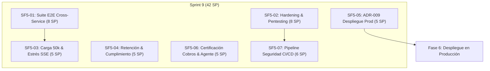

# Fase 5 — Pruebas integrales, seguridad y cumplimiento (Sprint 9)

> **Ventana:** 2027-01-25 → 2027-02-05 · **Equipo:** 2 personas (Farid y Juancho) · **Capacidad:** 42 SP planificados sobre 42 disponibles (Sprint 9)
> **Issues:** [`ISSUES.md`](ISSUES.md) (#78–#84) · **Epic:** [#77](https://gitlab.com/coffelovers2/mybusiness/-/work_items/77) · **Plan marco:** [`../../PLAN-INTEGRAL-DESARROLLO.md`](../../PLAN-INTEGRAL-DESARROLLO.md) · **Fase previa:** [`../fase-4/README.md`](../fase-4/README.md) · **ADR-009:** [`../../adr/009-production-deployment-target.md`](../../adr/009-production-deployment-target.md) · **Seguridad:** [`../../security.md`](../../security.md)

## 1. Objetivo de la fase

Consolidar y certificar la estabilidad, seguridad, rendimiento y cumplimiento normativo de la plataforma MyBusiness de forma integral antes del lanzamiento a producción (Fase 6).

Al cerrar la fase:

1. Todos los flujos de negocio multi-servicio (Open Banking Plaid + OCR facturas + Conciliación contable + Cobros PayPal + Agente conversacional con streaming y herramientas MCP) están certificados mediante pruebas E2E cross-service en escenarios convergentes.
2. La plataforma resiste pruebas de penetración locales (aislamiento estricto de tenant en RPC/BFF, salvaguarda de último admin, protección contra inyecciones y falsificación de peticiones).
3. La arquitectura soporta la carga masiva objetivo (50.000 transacciones concurrentes en colas BullMQ/Postgres y saturación de conexiones persistentes SSE en el BFF) con SLOs estables.
4. Se implementan y verifican los mecanismos de retención, purga de auditoría y derecho al olvido (GDPR/Habeas Data) garantizando la inmutabilidad de los registros contables.
5. Queda aprobado el **ADR-009** que define la arquitectura de despliegue para producción (Kubernetes vs contenedores gestionados) y los pipelines de GitLab CI incorporan escaneos de seguridad estricta y DAST bloqueantes.

## 2. Alcance

**Dentro**

- Suite de pruebas integrales cross-service de punta a punta entre `auth-service`, `finance-service`, `agent-service`, `audit-service`, `api-gateway` y `apps/web`.
- Hardening y pentesting local: validación de vectores OWASP Top 10, anti-bypass multi-tenant, sanitización de inputs y rate-limiting distribuido bajo ataque.
- Prueba de carga y estrés masivo (50k transacciones en lote, concurrencia en BullMQ, saturación de SSE en BFF y métricas p95 de base de datos).
- Políticas de retención y purga segura de auditoría (`audit_events` y `audit_dead_letters`), junto con flujos de anonimización / portabilidad de datos de usuario respetando la integridad financiera inmutable.
- Redacción y aprobación del ADR-009 (destino de producción) y diseño de manifiestos/Helm charts base con gestión externa de secretos y healthchecks de liveness/readiness.
- Certificación del ciclo de cobros PayPal con sandbox real y ampliación del set dorado del agente (>50 casos) con evaluación automatizada de no-alucinación y exactitud aritmética.
- Pipeline de GitLab CI con escaneo de seguridad estricto (Trivy container scanning, `pnpm audit` bloqueante, SAST SonarCloud Quality Gate y DAST baseline OWASP ZAP sobre staging).

**Fuera**

- Despliegue productivo final en infraestructura de nube pública (Fase 6).
- Gestión y rotación de certificados TLS de producción con DNS público definitivo (Fase 6).
- Soporte para plataformas móviles adicionales (iOS/Flutter excluidas según ADR-006).
- Nuevas pasarelas de pago distintas de PayPal (ej. Stripe o pasarelas locales).
- Cambios funcionales en el modelo de dominio contable o rediseño de interfaz de usuario.

## 3. Prerrequisitos

| Requisito                                                  | Motivo de bloqueo                                                                                                                     |
| ---------------------------------------------------------- | ------------------------------------------------------------------------------------------------------------------------------------- |
| Fase 4 cerrada (#54–#66)                                   | Sin el streaming funcional, passkeys, administración de tenant y notificaciones móviles no es posible validar la plataforma completa. |
| Entorno de staging en GitLab CI operativo                  | La ejecución de DAST y validación de contenedores requiere el runner y staging configurados (`161.35.168.244`).                       |
| Credenciales Sandbox de PayPal y Plaid activas             | Las pruebas integrales cross-service ejecutan validaciones contra los sandboxes oficiales.                                            |
| Contenedores Postgres 16 con `pgvector` y Redis 7 estables | Las pruebas de carga masiva y estrés requieren persistencia y colas sin degradación local.                                            |

## 4. Calendario y capacidad

| Sprint | Fechas                  | Foco                                                                                  | SP  |
| ------ | ----------------------- | ------------------------------------------------------------------------------------- | --- |
| 9      | 2027-01-25 → 2027-02-05 | Pruebas integrales, pentesting, carga masiva, cumplimiento, ADR-009 y CI de seguridad | 42  |

### Reparto de Capacidad

| Persona   | GitLab                  | Sprint 9 | Total  |
| --------- | ----------------------- | -------- | ------ |
| Farid     | `@farid15berrio10-a11y` | 24       | 24     |
| Juancho   | `@JuanchR4`             | 18       | 18     |
| **Total** |                         | **42**   | **42** |

- **Farid (@farid15berrio10-a11y — 24 SP):** Hardening y pentesting local (SF5-02, 8 SP), Retención y cumplimiento GDPR/Habeas Data (SF5-04, 5 SP), Decisión y arquitectura de despliegue en producción ADR-009 (SF5-05, 5 SP), Pipeline de seguridad integral y dependencias en GitLab CI (SF5-07, 6 SP).
- **Juancho (@JuanchR4 — 18 SP):** Suite de pruebas integrales E2E cross-service (SF5-01, 8 SP), Prueba de carga masiva 50k y estrés de concurrencia SSE (SF5-03, 5 SP), Certificación de cobros PayPal y set dorado del agente ampliado (SF5-06, 5 SP).

## 5. Matriz de dependencias y camino crítico

## 6. Riesgos y mitigaciones

| Riesgo                                                                                 | Probabilidad | Impacto | Mitigación                                                                                                                                                   |
| -------------------------------------------------------------------------------------- | ------------ | ------- | ------------------------------------------------------------------------------------------------------------------------------------------------------------ |
| Cuello de botella en PostgreSQL ante carga masiva de 50.000 transacciones              | Media        | Alto    | Optimizar índices B-Tree en `(tenant_id, posted_at)`, ajustar `pool_size` en Drizzle y desacoplar escrituras mediante colas BullMQ.                          |
| Incompatibilidad entre derecho al olvido (anonimización) y libros contables inmutables | Alta         | Alto    | Aplicar anonimización determinista de PII (nombre, email, RFC) reemplazando con pseudónimos hash sin alterar importes, fechas ni balances en el libro mayor. |
| Falsos positivos en análisis DAST de OWASP ZAP bloqueando pipelines                    | Media        | Medio   | Calibrar reglas de exclusión para CSRF en tokens sellados y rutas estáticas de Next.js antes de activar el modo bloqueante.                                  |

## 7. Criterio de salida de la Fase 5 (Definition of Done)

- [ ] Todos los flujos cross-service de negocio pasan con éxito en el arnés de pruebas automatizado.
- [ ] La auditoría de seguridad y pentesting concluye con 0 vulnerabilidades Críticas y Altas.
- [ ] La prueba de carga de 50.000 transacciones y estrés SSE procesa el 100% de los mensajes sin pérdida de datos ni caídas de servicio.
- [ ] La purga y anonimización de datos cumple con las regulaciones sin comprometer la cuadratura contable.
- [ ] El ADR-009 está redactado, revisado y aprobado por el equipo técnico.
- [ ] El pipeline de CI/CD en GitLab ejecuta escaneos SAST/DAST y auditoría de dependencias en verde.
